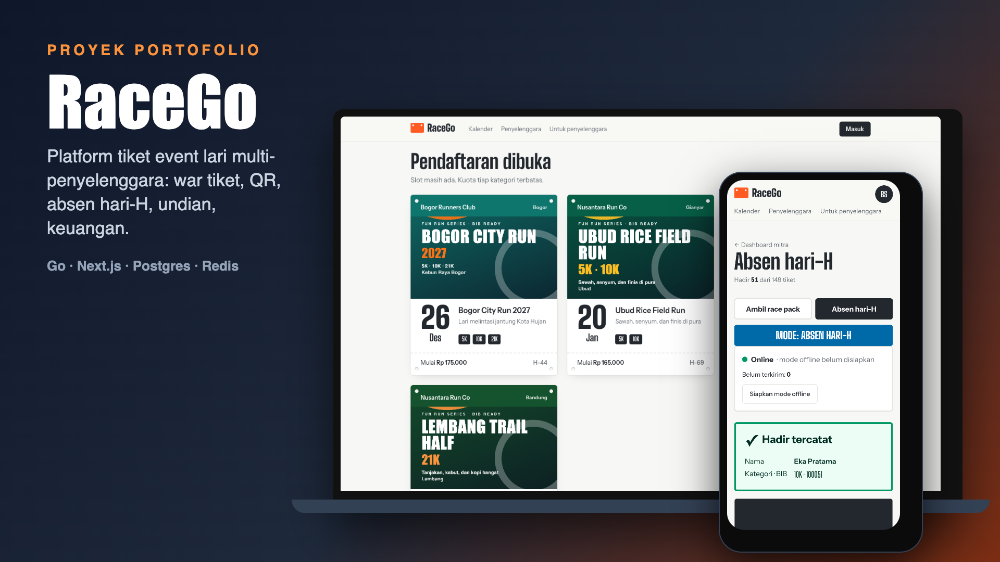
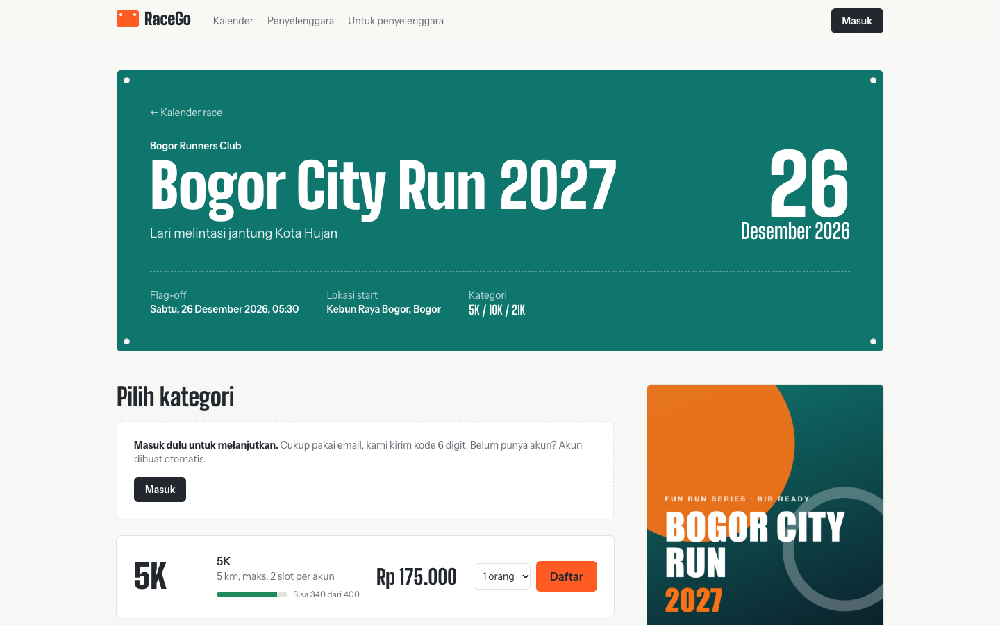
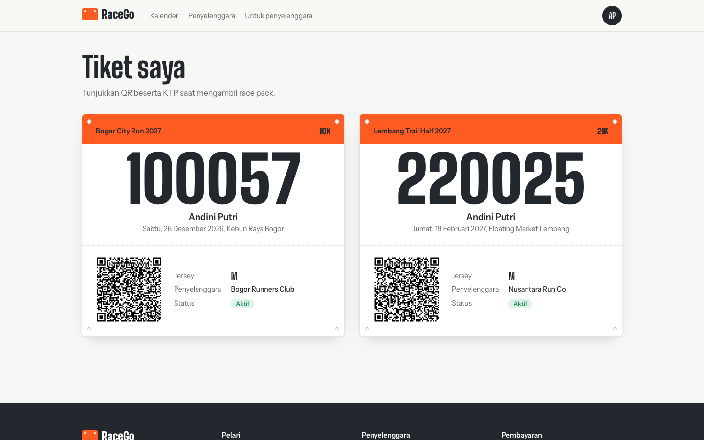
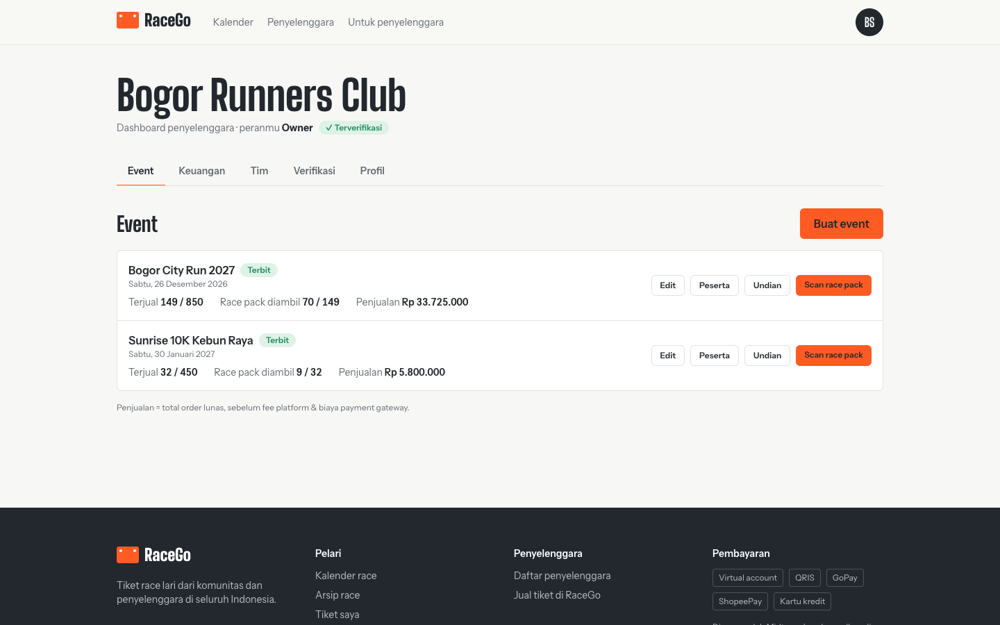
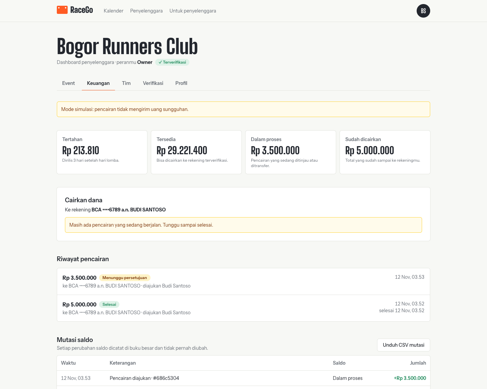
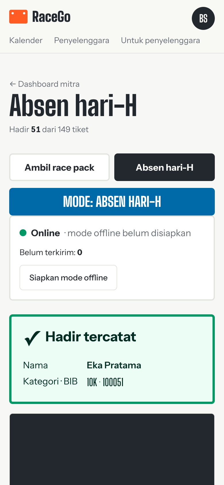
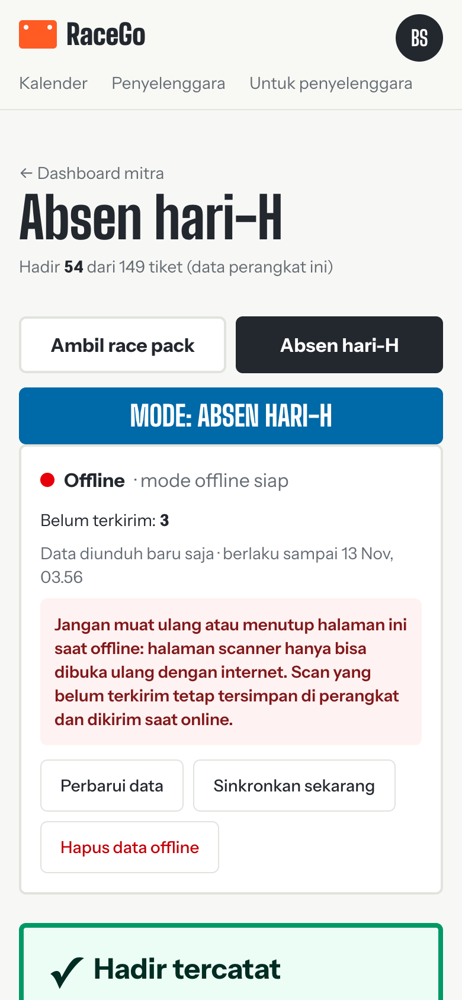
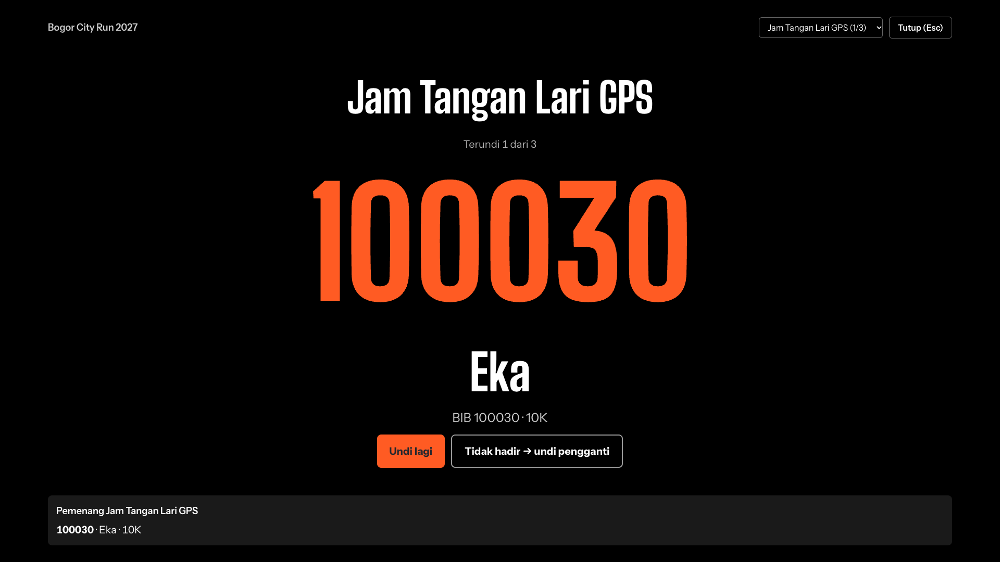
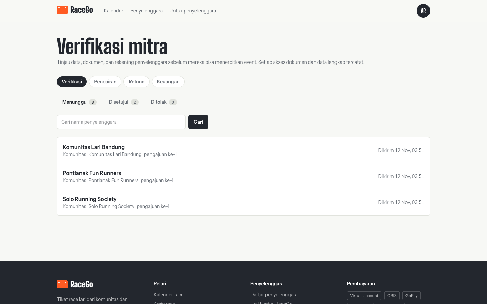
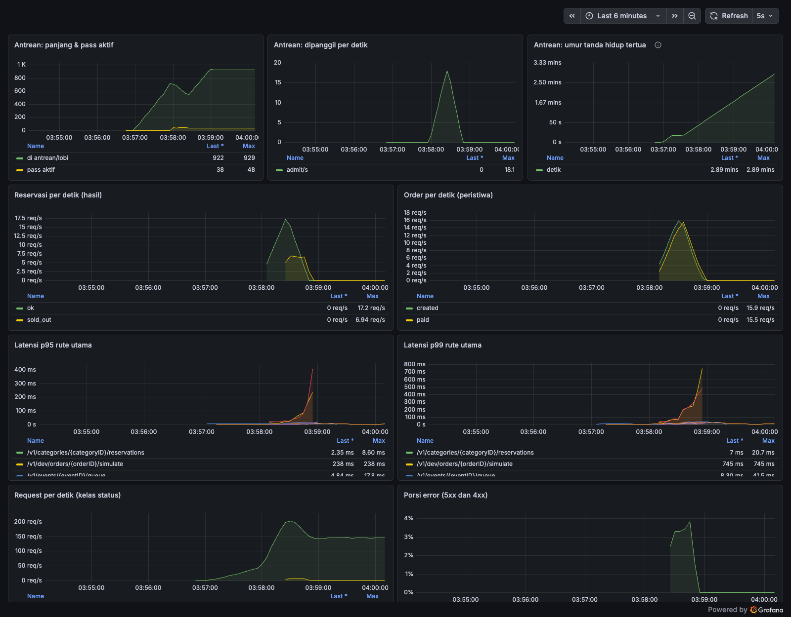

# RaceGo

[](https://github.com/gavinadlan/racego/actions/workflows/ci.yml)

Platform tiket event lari **multi-penyelenggara**: banyak company/komunitas menjual tiket fun run 5K, 10K, half marathon, dan full marathon di satu web. Pembayaran lewat **Midtrans**, tiket **QR** terbit otomatis setelah lunas, dan staf mitra men-scan QR saat pengambilan race pack — semuanya dirancang tahan **war tiket** (puluhan ribu orang di detik yang sama), dengan **antrian virtual** opsional untuk event yang paling diburu.

> Proyek pribadi / portofolio. Infra 100% gratis, pembayaran memakai Midtrans **sandbox** atau mode **mock**.



## Sorotan

- **War tiket yang tahan beban:** antrian virtual + reservasi stok atomik di Redis (Lua). Diuji k6 dengan 5.000 pengguna berebut 500 tiket: 0 error 5xx, 0 oversell, p95 reservasi 1,8 ms dengan antrean ([hasil](docs/11-performa.md)).
- **Tiket tidak pernah melebihi kuota** walau Redis crash: pagar kuota di database, rekonsiliasi stok, dan uji `SIGKILL`/`FLUSHALL` ([docs/03](docs/03-war-tiket.md)).
- **QR bertanda tangan Ed25519 + scanner offline:** pengambilan race pack dan absen hari-H tanpa internet, sinkron batch idempoten, bentrokan antar-perangkat masuk "Perlu ditinjau".
- **Undian doorprize yang adil:** hanya peserta yang benar-benar hadir, diundi di server dengan `crypto/rand`, hash kumpulan peserta tercatat ([docs/12](docs/12-undian.md)).
- **Multi-tenant + KYC:** peran owner/admin/keuangan/staf, dokumen verifikasi terenkripsi AES-256-GCM, peninjauan super admin.
- **Keuangan:** ledger double-entry append-only (dijaga trigger), pencairan maker-checker, refund, laporan CSV.
- **Bisa diamati:** metrik Prometheus dan dashboard Grafana, semuanya berjalan di infra gratis.

## Tampilan

Semua data di gambar ini fiktif.

| | |
| --- | --- |
|  |  |
| Detail event dan pilihan kategori | Tiket QR dengan nomor BIB |
|  |  |
| Dashboard penyelenggara | Saldo, pencairan, dan mutasi |
|  |  |
| Scanner absen hari-H di HP | Mode offline dengan antrean sinkron |
|  |  |
| Layar panggung undian doorprize | Antrean verifikasi mitra (super admin) |



Dashboard Grafana saat war tiket 1.500 pengguna. Lonjakan 4xx sekitar 3–4% adalah jawaban "kuota habis", bukan galat server.

## Isi repo

```
RaceGo/
├── backend/            API + worker (Go, modular monolith)
│   ├── cmd/            api · worker · migrate · keygen · healthcheck
│   ├── internal/       checkout · queue · payment · ticket · ledger · finance · tenant · event · worker · ...
│   └── migrations/     skema SQL + seed data contoh
├── frontend/           Web Next.js 16 (pelari, dashboard mitra, scanner race pack)
├── docs/               PRD, arsitektur, war tiket, pembayaran, tiket QR, infra gratis, API, deploy, ADR
├── loadtest/           Uji beban k6: browse · war · war-noqueue · soak + pemeriksaan integritas
├── deploy/Caddyfile    Reverse proxy produksi (HTTPS otomatis, header keamanan)
├── deploy/obs/         Prometheus + dashboard Grafana lokal (opsional, bukan bagian produksi)
├── scripts/            gen-secrets · backup · restore · demo · check-ip-spoof · queue-sim
├── docker-compose.yml       Postgres · Redis · Mailpit untuk development
├── docker-compose.prod.yml  Stack produksi lengkap (caddy, web, api, worker, postgres, redis)
├── docker-compose.loadtest.yml · docker-compose.obs.yml   Infra uji beban & observabilitas lokal
├── .github/workflows/  CI: tes backend + Postgres, build frontend, build image
└── Makefile            Semua perintah sehari-hari (`make help`)
```

## Mulai cepat (macOS)

Prasyarat: **Go ≥ 1.27** (go.mod memakai toolchain go1.27.4; Go yang lebih lama mengunduhnya otomatis), **Node.js ≥ 20**, **Docker** (Docker Desktop / OrbStack / Colima). Detail di [docs/08-development.md](docs/08-development.md).

```bash
make setup     # buat .env, unduh dependensi Go & npm (sekali saja)
make up        # nyalakan Postgres, Redis, Mailpit
make migrate   # buat tabel
make seed      # isi data contoh: 5 penyelenggara, 17 event, 4 user
make dev       # jalankan API (:8080) + worker + web (:3000)
```

Buka http://localhost:3000 lalu klik **Masuk**: isi email, kode 6 digit muncul di log `make dev` (dan di Mailpit/Gmail). Jadikan akunmu staf/owner mitra dengan `make grant EMAIL=kamu@gmail.com ORG=jakarta-runners ROLE=owner`.

Atau pakai akun contoh di menu **Akun contoh (dev)** (kanan atas):

| User | Peran | Coba ini |
| --- | --- | --- |
| Budi | Pelari | Cari race di beranda → daftar 5K untuk 2 orang → simulasikan bayar → lihat tiket BIB di **Tiket saya** |
| Sari | Owner Jakarta Runners | Dashboard mitra: penjualan & progres race pack |
| Andi | Staf RPC Jakarta | **Scan race pack**: QR valid → hijau, scan ulang → kuning |
| Rina | Owner Bandung Trail | Coba buka data Jakarta → ditolak (isolasi multi-tenant) |
| Akunmu sendiri | Calon mitra | Menu akun → **Jadi penyelenggara** → buat event (kategori, poster) → **Terbitkan** → event muncul di beranda; undang staf lewat email di tab **Tim** |

Email tiket tertangkap di Mailpit: http://localhost:8025. Postgres berjalan di port **55432** dan Redis di **6380** (bukan port bawaan) supaya tidak bentrok dengan instalasi lain di Mac.

## Perintah penting

| Perintah | Fungsi |
| --- | --- |
| `make test` | Tes backend (termasuk 1.000 pembeli berebut 50 slot → tepat 50 sukses) + lint & type-check frontend |
| `make db-reset` | Hapus semua data lalu migrasi + seed ulang |
| `make grant EMAIL=… ORG=… ROLE=…` | Beri akun sungguhan peran di penyelenggara |
| `make superadmin EMAIL=…` | Jadikan akun super admin: meninjau verifikasi mitra di `/admin` |
| `make verify ORG=…` | Jalan pintas: verifikasi penyelenggara tanpa pengajuan (bila `AUTO_VERIFY_ORGS=false`) |
| `make dev-release ORG=…` | Development: rilis saldo tertahan mitra tanpa menunggu masa tahan (uji pencairan) |
| `make keygen` | Buat kunci Ed25519 untuk tanda tangan QR |
| `make loadtest-up` / `make loadtest SCENARIO=… USERS=…` / `make loadtest-clean` | Uji beban k6 di infra terpisah + pemeriksaan integritas otomatis ([hasil](docs/11-performa.md)) |
| `make obs-up` / `make obs-down` | Prometheus + Grafana lokal untuk melihat metrik (opsional) |
| `make queue-demo` / `make queue-load` | Event demo ber-antrian untuk dicoba di browser / uji beban antrian virtual (10.000 pengguna palsu) |
| `make prod-up` / `make demo` | Stack produksi di server / demo dari laptop (lihat [Deploy](#deploy)) |

## Deploy

Satu perintah menjalankan seluruh aplikasi dalam mode produksi di server Linux mana pun yang punya Docker, dengan HTTPS otomatis (Caddy + Let's Encrypt) di satu alamat:

```bash
cp .env.prod.example .env.prod
scripts/gen-secrets.sh        # password acak + kunci QR & KYC (cadangkan kuncinya terpisah dari backup!)
nano .env.prod                # SITE_ADDRESS, SMTP, Midtrans sandbox
make prod-up                  # build, migrasi otomatis, tunggu semua sehat
```

Demo sementara dari laptop tanpa server atau domain: `make demo` (butuh `cloudflared`; alamat `https://….trycloudflare.com` berubah setiap dinyalakan). Backup terjadwal: `make backup` / `make restore FILE=…`. Panduan langkah demi langkah untuk pemula, checklist keamanan, dan troubleshooting: [docs/10-deploy.md](docs/10-deploy.md).

## Status

| Sudah jalan | Belum (lihat [docs/09-roadmap.md](docs/09-roadmap.md)) |
| --- | --- |
| Login email + kode OTP, sesi cookie, halaman akun | Login Google |
| Beranda: pencarian, race terdekat + hitung mundur, segera dibuka, kalender, arsip | |
| Kalender bulanan & daftar, arsip race, halaman penyelenggara | 2FA super admin, retensi data verifikasi |
| Multi-tenant (mitra, peran, isolasi data) | |
| Reservasi atomik Redis + timer + pengembalian kuota; **pagar kuota di database** (tiket tidak pernah melebihi kuota walau Redis rusak) + rekonsiliasi stok/batas per pembeli ([docs/03](docs/03-war-tiket.md#pelindung-berlapis-tugas-11)) | Anti multi-akun, ballot (Turnstile opsional sudah ada) |
| Antrian virtual opsional per event (lobi diundi, pemanggilan bertahap, pass HMAC) | Antrian lintas event |
| Order idempotent, Midtrans Snap (sandbox) & mode mock | Pencairan ke Iris sandbox sungguhan (klien teruji server palsu), ganti rekening |
| Webhook idempotent + verifikasi signature + outbox | Undangan massal (CSV) |
| Portal mitra: daftar penyelenggara, buat/terbitkan event, poster & logo, tim, undangan staf via email | Kupon & harga bertahap |
| Verifikasi mitra: dokumen & rekening terenkripsi, peninjauan super admin `/admin` | Rotasi kunci enkripsi |
| Tiket QR bertanda tangan Ed25519 + BIB otomatis | Enkripsi data scanner offline (PIN), refund parsial/massal |
| Scanner race pack + absen hari-H (kamera, manual, anti dobel scan, mode offline + sinkron); undian doorprize spin BIB ([docs/12-undian.md](docs/12-undian.md)) | Row-Level Security Postgres |
| Ledger double-entry append-only + email tiket | Alerting, tracing, log terpusat |
| Metrik Prometheus + dashboard Grafana lokal; uji beban k6 terukur ([docs/11-performa.md](docs/11-performa.md)) | Uji beban dari mesin terpisah / jaringan nyata |
| Keuangan mitra: saldo tertahan/tersedia, pencairan maker-checker (mock / Midtrans Payouts), refund per order, laporan CSV, cek integritas ledger; daftar & export CSV peserta per event; anti-bot Turnstile opsional (OTP & antrean) | Rekonsiliasi settlement Midtrans, kuota kembali setelah refund |

Dokumen PRD & arsitektur lengkap: [docs/](docs/README.md).
