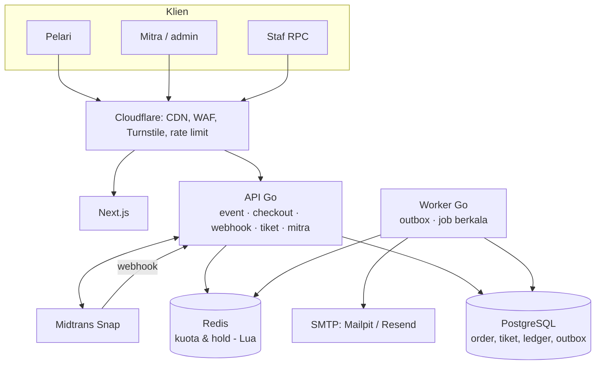
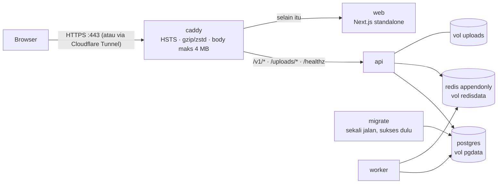

# 02 · Arsitektur

Modular monolith: satu codebase Go yang di-deploy sebagai dua proses (`api` dan `worker`), dengan PostgreSQL sebagai sumber kebenaran dan Redis untuk kuota yang diperebutkan.

## Modul backend (`backend/internal/`)

| Modul | Tanggung jawab |
| --- | --- |
| `checkout` | Kuota di Redis (skrip Lua `reserve` / `release` / `confirm`), reservasi, pembuatan order |
| `payment` | Snap client (HTTP & mock), verifikasi & pemrosesan webhook Midtrans |
| `ticket` | Tanda tangan QR Ed25519, penerbitan tiket + BIB, scan race pack |
| `ledger` | Jurnal double-entry, fee platform, estimasi biaya PG |
| `tenant` | Middleware multi-tenant: slug mitra → `org_id` + cek peran |
| `event` | Katalog publik (hanya event terbit dari mitra terverifikasi), ringkasan penjualan mitra |
| `partner` | Portal mitra: daftar penyelenggara, profil, CRUD event & kategori, terbitkan/tutup, anggota tim, audit |
| `upload` | Validasi & simpan gambar (poster, logo) di balik antarmuka `Storage` (sekarang disk lokal) |
| `worker` | Memproses outbox dan job berkala (muat stok, kembalikan slot, expire order) |
| `auth` | Login email + OTP, sesi cookie, profil `/me`, middleware identitas & CSRF |
| `notify` | Email tiket & kode masuk (SMTP, batas waktu 10 detik) |

Aturan dependensi: modul boleh saling impor ke arah "bawah" saja (`checkout` → `ledger`, `payment`), tidak melingkar. Ini membuat modul bisa dipecah jadi layanan terpisah nanti tanpa menulis ulang.

## Alur data utama

1. **Reservasi** — API membaca info kategori (cache 3 detik), lalu satu skrip Lua di Redis mengurangi stok dan membuat hold ber-timer.
2. **Order** — reservasi + data peserta disimpan sebagai order `pending` di Postgres (idempotent lewat header `Idempotency-Key`), lalu token Snap dibuat.
3. **Webhook** — Midtrans memanggil `/v1/webhooks/midtrans`. Signature diverifikasi, event dicatat unik per `(order, status)`, status order hanya bergerak maju, dan pesan `order.paid` ditulis ke tabel `outbox` **dalam transaksi yang sama**.
4. **Worker** — mengambil pesan outbox (`FOR UPDATE SKIP LOCKED`), mengunci slot di Redis, menerbitkan tiket, menulis jurnal ledger, lalu mengantrekan email. Setiap langkah idempotent; gagal → retry dengan backoff.

## Login & sesi

- **Tanpa password**: email → kode 6 digit dikirim langsung dari API (`notify.Mailer`) → verifikasi → masuk. Akun dibuat otomatis saat verifikasi pertama.
- **Kode OTP di Redis**: key `otp:{email}` berisi SHA-256 dari `kode + email` dan jumlah percobaan salah, TTL 10 menit, dibandingkan dengan `subtle.ConstantTimeCompare`, hangus setelah 5× salah atau sekali berhasil. Batas kirim (INCR + EXPIRE): 60 detik antar kirim & 5/jam per email, 20/jam per IP.
- **Sesi di Postgres** (tabel `sessions`): token acak 32 byte hanya ada di cookie `racego_session` (HttpOnly, `SameSite=Lax`, host-only, 30 hari, `Secure` di luar development); DB hanya menyimpan SHA-256-nya. `last_seen_at` diperbarui paling sering 5 menit sekali. Bukan JWT: sesi bisa dicabut seketika (logout menghapus barisnya).
- **Middleware** (`auth.Middleware`): cookie sesi valid → user; bila tidak ada dan `APP_ENV=development` → header `X-User-ID` (akun contoh). Di luar development header itu diabaikan.
- **CSRF**: `SameSite=Lax` + tolak request yang mengubah data bila `Origin` bukan `FRONTEND_URL` (403 `bad_origin`).
- **Peran mitra**: pendaftar penyelenggara otomatis `owner`; owner menambah anggota lain dari tab **Tim**. `make grant` tetap ada untuk keperluan development.

## Portal mitra: penerbitan event & stok

- **Status event**: `draft` → `published` → `closed`. Hanya `published`/`closed` dari mitra `verified` yang tampil publik; draft 404 di semua endpoint publik. `closed` tetap tampil (arsip & pemegang tiket) tetapi reservasi dan order ditolak.
- **Verifikasi**: org baru `pending` (atau langsung `verified` bila `AUTO_VERIFY_ORGS=true`, default di development). `pending` boleh membuat draft tapi tidak boleh menerbitkan; `make verify ORG=slug` untuk memverifikasi.
- **Terbitkan** (`POST …/publish`): cek org terverifikasi, minimal 1 kategori, validasi ulang semua kolom, penjualan belum lewat; lalu status jadi `published` dan **stok semua kategori langsung dimuat ke Redis** (`checkout.SyncCategory`, SETNX) tanpa menunggu worker. Worker tetap menyinkronkan tiap 30 detik sebagai cadangan.
- **Setelah ada penjualan** (order selain `cancelled`/`expired`): kode, harga, jarak, prefix BIB terkunci. Kuota boleh berubah selama tidak di bawah slot terpakai. Perubahan kuota menyesuaikan stok Redis dengan **selisih** lewat skrip Lua `adjust.lua` yang atomik (cek `stok + selisih >= 0`), bukan menimpa angka absolut, karena pembelian bisa sedang berjalan. Penyesuaian Redis dilakukan tepat sebelum commit; bila commit gagal, selisihnya dibatalkan.
- **Hapus**: hanya draft / kategori tanpa order. Event berpenjualan hanya bisa **ditutup** (refund belum ada).
- **Audit**: org dibuat/diubah, event dibuat/diubah/terbit/kembali ke draft/ditutup/dihapus, kategori dibuat/diubah/dihapus, anggota ditambah/diubah/dihapus → `audit_logs` (before/after JSON).
- **Batas**: 3 org per akun pembuat (429 `too_many_orgs`), 20 draft per org (422 `too_many_drafts`).

## Penyimpanan gambar

- `POST /v1/org/{org}/uploads` (owner/admin) menerima JPEG/PNG maks 3 MB, sisi terpanjang maks 4.000 px. Tipe ditentukan dari **isi file** (`http.DetectContentType` + `image.DecodeConfig`/`Decode`), lalu gambar di-**encode ulang** sehingga EXIF/GPS hilang.
- Nama file = SHA-256 isi + `.jpg`/`.png`: tidak bisa ditebak, tidak menimpa file lain, dan aman di-cache `immutable`. DB menyimpan path relatif `/uploads/<hash>.jpg`.
- `upload.Storage` (sekarang `upload.Disk` di `UPLOAD_DIR`: default `backend/data/uploads`, di stack produksi volume `uploads` yang ikut `make backup`) bisa diganti S3/R2 tanpa mengubah handler. `GET /uploads/{name}` hanya menerima nama `^[a-f0-9]{64}\.(jpg|png)$` (tanpa path traversal). File yang tidak dipakai lagi belum dibersihkan otomatis.

## Deploy

Satu server, satu `docker-compose.prod.yml` (proyek `racego-prod`). Caddy satu-satunya pintu masuk dan satu origin untuk web + API, sehingga tidak ada CORS/cookie lintas domain. Langkah lengkap: [10-deploy.md](10-deploy.md).

- Image backend tunggal (distroless, non-root) berisi `api`, `worker`, `migrate`, `keygen`, dan `healthcheck` (probe Docker tanpa curl). Image web memakai `output: "standalone"` dan `NEXT_PUBLIC_API_URL=""`, sehingga tidak bergantung alamat situs.
- Hanya Caddy yang punya `ports:`. Redis wajib password, Postgres memakai user/password acak dari `scripts/gen-secrets.sh`.
- `api`/`worker` baru start setelah `migrate` sukses (`service_completed_successfully`). Setiap service punya healthcheck, `restart: unless-stopped`, log berotasi, batas memori, dan `read_only` di mana praktis.

## Multi-tenancy

- Satu database bersama; setiap tabel milik mitra punya kolom `org_id`.
- Semua route mitra berada di `/v1/org/{org}/...` dan melewati `tenant.RequireRole`, yang mengubah slug menjadi `org_id` dan memeriksa keanggotaan + peran.
- Handler **wajib** memakai `tenant.FromContext(ctx).OrgID` di setiap query, tidak pernah `org_id` dari body request.
- User yang bukan anggota mendapat 404 (bukan 403) agar keberadaan mitra lain tidak bocor.
- Pelari bersifat global (bukan milik satu mitra), sehingga satu akun bisa membeli di event mitra mana pun.

Rencana penguatan: Row-Level Security Postgres sebagai jaring pengaman kedua — lihat [ADR 0002](adr/0002-multi-tenant-shared-db.md).

## Skema data

Lihat `backend/migrations/0001_init.up.sql`. Tabel inti: `organizations`, `org_members`, `events`, `ticket_categories`, `orders`, `participants`, `tickets`, `payment_events`, `outbox`, `ledger_journals`, `ledger_entries`, `payouts`, `scan_logs`, `audit_logs`. Semua nominal uang disimpan sebagai `BIGINT` rupiah.
