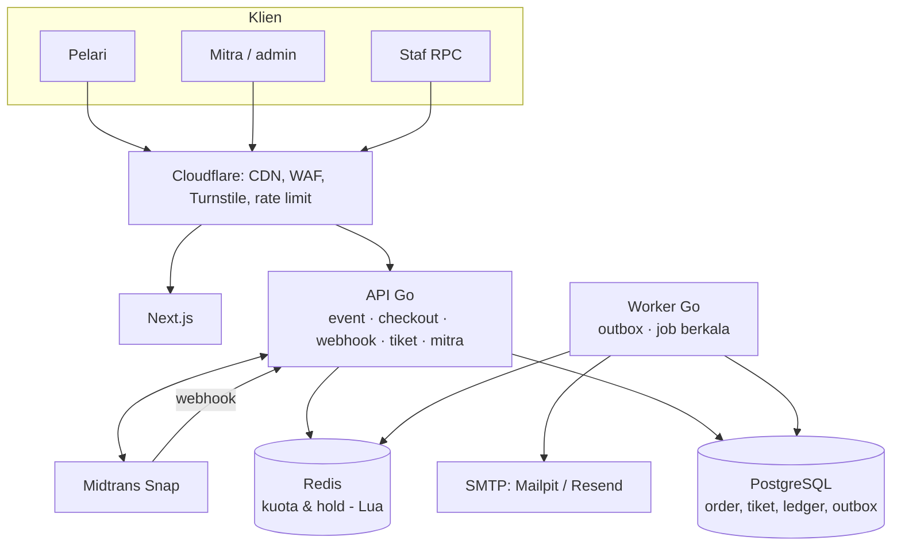

# 02 · Arsitektur

Modular monolith: satu codebase Go yang di-deploy sebagai dua proses (`api` dan `worker`), dengan PostgreSQL sebagai sumber kebenaran dan Redis untuk kuota yang diperebutkan.

## Modul backend (`backend/internal/`)

| Modul | Tanggung jawab |
| --- | --- |
| `checkout` | Kuota di Redis (skrip Lua `reserve` / `release` / `confirm`), reservasi, pembuatan order |
| `payment` | Snap client (HTTP & mock), verifikasi & pemrosesan webhook Midtrans |
| `ticket` | Tanda tangan QR Ed25519, penerbitan tiket + BIB, scan race pack |
| `ledger` | Jurnal double-entry, fee platform, estimasi biaya PG |
| `tenant` | Middleware multi-tenant: slug mitra → `org_id` + cek peran |
| `event` | Katalog publik, dashboard mitra, profil `/me` |
| `worker` | Memproses outbox dan job berkala (muat stok, kembalikan slot, expire order) |
| `auth` | Identitas user (sementara: header `X-User-ID` di development) |
| `notify` | Email tiket |

Aturan dependensi: modul boleh saling impor ke arah "bawah" saja (`checkout` → `ledger`, `payment`), tidak melingkar. Ini membuat modul bisa dipecah jadi layanan terpisah nanti tanpa menulis ulang.

## Alur data utama

1. **Reservasi** — API membaca info kategori (cache 3 detik), lalu satu skrip Lua di Redis mengurangi stok dan membuat hold ber-timer.
2. **Order** — reservasi + data peserta disimpan sebagai order `pending` di Postgres (idempotent lewat header `Idempotency-Key`), lalu token Snap dibuat.
3. **Webhook** — Midtrans memanggil `/v1/webhooks/midtrans`. Signature diverifikasi, event dicatat unik per `(order, status)`, status order hanya bergerak maju, dan pesan `order.paid` ditulis ke tabel `outbox` **dalam transaksi yang sama**.
4. **Worker** — mengambil pesan outbox (`FOR UPDATE SKIP LOCKED`), mengunci slot di Redis, menerbitkan tiket, menulis jurnal ledger, lalu mengantrekan email. Setiap langkah idempotent; gagal → retry dengan backoff.

## Multi-tenancy

- Satu database bersama; setiap tabel milik mitra punya kolom `org_id`.
- Semua route mitra berada di `/v1/org/{org}/...` dan melewati `tenant.RequireRole`, yang mengubah slug menjadi `org_id` dan memeriksa keanggotaan + peran.
- Handler **wajib** memakai `tenant.FromContext(ctx).OrgID` di setiap query, tidak pernah `org_id` dari body request.
- User yang bukan anggota mendapat 404 (bukan 403) agar keberadaan mitra lain tidak bocor.
- Pelari bersifat global (bukan milik satu mitra), sehingga satu akun bisa membeli di event mitra mana pun.

Rencana penguatan: Row-Level Security Postgres sebagai jaring pengaman kedua — lihat [ADR 0002](adr/0002-multi-tenant-shared-db.md).

## Skema data

Lihat `backend/migrations/0001_init.up.sql`. Tabel inti: `organizations`, `org_members`, `events`, `ticket_categories`, `orders`, `participants`, `tickets`, `payment_events`, `outbox`, `ledger_journals`, `ledger_entries`, `payouts`, `scan_logs`, `audit_logs`. Semua nominal uang disimpan sebagai `BIGINT` rupiah.
