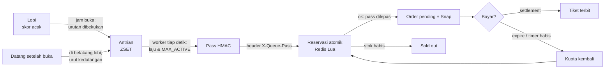

# 03 · War tiket: menahan lonjakan checkout

Prinsipnya: puluhan ribu orang tidak boleh menyentuh database sekaligus. Potong kuota secara atomik di Redis, kerjakan sisanya secara asinkron, dan untuk event yang sangat diburu, atur arus pembeli dengan antrian virtual.



Event tanpa antrian langsung masuk di "Reservasi atomik": tidak ada pass, tidak ada biaya Redis tambahan.

## Yang sudah diimplementasikan

| Lapis | Implementasi | File |
| --- | --- | --- |
| Reservasi atomik | Skrip Lua: cek batas per akun, cek & kurangi stok, simpan hold ber-TTL — dalam satu operasi | `checkout/lua/reserve.lua` |
| Nol oversell | Tes: 1.000 goroutine berebut 50 slot → tepat 50 sukses | `checkout/inventory_test.go` |
| Pengembalian kuota | Hold kedaluwarsa (indeks ZSET) & order expired dikembalikan worker tiap 15 detik, grace 2 menit | `worker/worker.go`, `lua/release.lua` |
| Bayar telat | `confirm.lua`: hold masih aktif → kunci; sudah lepas tapi stok ada → ambil ulang; stok habis → order `needs_refund` | `lua/confirm.lua` |
| Idempotensi | `Idempotency-Key` per order, `reservation_id` unik, webhook unik per `(order, status)`, jurnal unik per order | `checkout/handler.go`, migrasi |
| Asinkron | Tiket, ledger, email dikerjakan worker dari tabel outbox | `payment/webhook.go`, `worker/` |
| Pre-warm stok | Stok dimuat ke Redis sejak 30 menit sebelum penjualan dibuka (`SETNX`, tidak pernah menimpa) | `checkout/sync.go` |
| Cache baca | Info kategori di-cache 3 detik di memori API | `checkout/handler.go` |
| Cluster-ready | Semua key satu kategori memakai hash tag `{cat:<id>}` agar berada di slot Redis Cluster yang sama | `checkout/inventory.go` |
| Antrian virtual (opsional per event) | Lobi + urutan acak, pemanggilan bertahap oleh worker, pass HMAC wajib untuk reservasi | `queue/`, `queue/lua/*.lua` |

## Belum dibuat (urut prioritas)

1. **Turnstile** di tombol Daftar + rate limit per NIK; deteksi akun ganda.
2. **Ballot** untuk event super-favorit (undian, tanpa lonjakan).
3. Antrian lintas event (satu antrian untuk beberapa event yang dibuka bersamaan).
4. Halaman tunggu statis dari CDN; circuit breaker ke Midtrans; feature flag untuk menutup penjualan darurat.

## Antrian virtual (waiting room)

Mitra mencentang **Aktifkan antrian virtual** di form event (owner/admin; terkunci setelah penjualan dibuka). Untuk event itu:

1. **Lobi** dibuka `QUEUE_LOBBY_MINUTES` (15) sebelum `sale_open_at`. Wajib login; satu tempat per akun (`ZADD NX`). Setiap peserta lobi mendapat skor acak 52-bit (`crypto/rand`) sekali saat bergabung.
2. **Jam buka**: urutan antrian = urutan skor, jadi waktu masuk lobi tidak berpengaruh. Yang bergabung setelah jam buka diberi skor `2^52 + waktu_ms`: selalu di belakang semua peserta lobi, berurutan menurut kedatangan. (2^52, bukan 2^53: skor ZSET adalah double, dan `2^52 + ms` masih bilangan bulat yang tepat.)
3. **Pemanggilan**: worker tiap detik menjalankan `admit.lua` per event: memanggil `min(QUEUE_ADMIT_PER_SEC × detik sejak panggilan terakhir, QUEUE_MAX_ACTIVE − pass aktif)` orang dari depan. Peserta yang tidak polling selama `QUEUE_HEARTBEAT_TTL` (45 detik) dilewati dan dibuang, jadi tab yang ditutup tidak memakan slot. Atomik di Redis, aman walau ada beberapa instance worker. Saat stok semua kategori 0 tapi masih ada hold (bisa kembali bila tidak dibayar), pemanggilan ditahan.
4. **Pass**: status `admitted` memuat token HMAC-SHA256 (`QUEUE_SECRET`) berisi event, user, dan kedaluwarsa (`QUEUE_PASS_TTL`, 10 menit). `POST /reservations` untuk event ber-antrian wajib header `X-Queue-Pass`; dicek tanda tangan (`hmac.Equal`), event, user, kedaluwarsa, **dan** keanggotaan di himpunan pass aktif Redis (agar bisa dicabut). Gagal → 403 `queue_required` / `queue_pass_expired`.
5. **Pass dilepas** saat reservasi pertama berhasil (pembeli punya 15 menit untuk checkout; **untuk kategori lain ia perlu antri lagi**), saat kedaluwarsa, atau saat keluar antrian (`DELETE`).
6. **Akhir**: semua kategori stok 0 dan tidak ada hold → `sold_out`; penjualan ditutup → `closed`. Semua yang menunggu melihat status itu pada polling berikutnya, dan key antrian event itu terhapus sendiri 10 menit kemudian. Bila mitra menambah kuota, antrian dibuka lagi.
7. **Polling dengan jitter dari server**: `poll_after_ms` = 2,5 detik di depan antrian, naik 10 ms per orang di depan sampai 15 detik, ±20% acak. Di lobi 15 detik; polling pertama setelah jam buka disebar 0,5–5 detik. `GET /queue/me` minimal 1 detik sekali per akun (429 `retry_after`); join/keluar dibatasi 20/menit per akun dan 300/menit per IP (`internal/ratelimit`, pembatas yang sama dengan OTP).
8. **Waktu dari server**: setiap status membawa `server_time`; hitung mundur di browser dikoreksi dengan selisih jam server.

Bila data Redis hilang total (meski `appendonly yes`), peserta mendapat `not_in_queue` dan halaman event mengajak bergabung lagi (di belakang); pass lama ditolak karena tidak ada lagi di himpunan pass aktif.

### Apa yang diselesaikan antrian, dan apa yang tidak

Reservasi Redis sendiri sudah murah (3.000 request ke 200 slot di laptop selesai tanpa error). Antrian **tidak** membuat reservasi lebih cepat; yang diselesaikannya:

- **Melindungi server kecil**: hanya `QUEUE_MAX_ACTIVE` orang yang memegang tombol Daftar sekaligus; sisanya hanya polling status yang sangat ringan (satu skrip Lua, tanpa Postgres) dengan jeda yang diatur server.
- **Keadilan**: yang sudah di lobi sebelum jam buka diundi, bukan siapa yang ping-nya paling cepat di detik pertama.
- **Pengalaman**: posisi, jumlah di depan, perkiraan waktu (dari laju panggil yang terukur; kosong bila belum ada data), bukan layar error atau refresh berulang.

Batas yang jujur:

- **Tidak mencegah akun ganda atau bot.** Satu orang dengan 50 akun mendapat 50 undian. Turnstile, verifikasi NIK, dan batas per identitas belum dibuat (roadmap).
- Halaman tunggu tetap dilayani API dan Next.js (belum dari CDN).
- Yang dipanggil saat stok sebentar lagi habis bisa mendapat "Habis" saat menekan Daftar: pemanggilan baru berhenti setelah stok benar-benar 0, dan pembeli butuh beberapa detik untuk melihat gilirannya.
- Saat stok 0 tapi masih ada hold, sisa antrian menunggu tanpa kepastian sampai hold dibayar (tiket habis) atau kedaluwarsa (slot kembali).

### Kunci Redis per event

| Key | Isi |
| --- | --- |
| `{ev:<id>}:queue` | ZSET antrian, skor = urutan (acak untuk lobi, `2^52 + ms` setelah buka) |
| `{ev:<id>}:seen` | ZSET tanda hidup, skor = waktu polling terakhir (ms) |
| `{ev:<id>}:active` | ZSET pass aktif, skor = kedaluwarsa (ms) |
| `{ev:<id>}:opened` | Penanda urutan lobi sudah dibekukan (jam buka) |
| `{ev:<id>}:meta` | HASH: `admitted_total`, jatah panggil, laju terukur (untuk perkiraan waktu) |
| `{ev:<id>}:final` | `sold_out` / `closed` (TTL 10 menit, bersama key lain) |
| `queue_rl:*` | Penghitung batas join/keluar/status |

Skrip: `queue/lua/join.lua`, `status.lua` (sekaligus heartbeat), `admit.lua`, `release.lua`. Key antrian punya batas umur 7 hari yang diperbarui setiap ada yang bergabung/dipanggil, supaya antrian event yang ditinggal tanpa status akhir (mis. ditarik ke draft) tidak menumpuk di Redis `noeviction`.

### Parameter (env)

| Variabel | Default | Arti |
| --- | --- | --- |
| `QUEUE_SECRET` | kunci dev bawaan (development saja) | Kunci HMAC pass, min. 32 karakter. Wajib di produksi; `scripts/gen-secrets.sh` membuatnya. Terpisah dari `QR_PRIVATE_KEY` |
| `QUEUE_LOBBY_MINUTES` | 15 | Lobi dibuka sekian menit sebelum penjualan |
| `QUEUE_ADMIT_PER_SEC` | 20 | Orang dipanggil per detik per event |
| `QUEUE_MAX_ACTIVE` | 300 | Pemegang pass maksimum sekaligus per event |
| `QUEUE_PASS_TTL` | 10m | Masa berlaku pass |
| `QUEUE_HEARTBEAT_TTL` | 45s | Tanpa polling selama ini = dibuang saat sampai di depan |

Default ini untuk server kecil (2 CPU). Naikkan `QUEUE_ADMIT_PER_SEC`/`QUEUE_MAX_ACTIVE` bila server terbukti kuat (`make queue-load`).

## Kunci Redis per kategori

| Key | Isi |
| --- | --- |
| `{cat:<id>}:stock` | Sisa stok |
| `{cat:<id>}:user:<uid>` | Jumlah slot yang dipegang user (batas per akun) |
| `{cat:<id>}:holds` | ZSET reservasi aktif, skor = waktu kedaluwarsa |
| `{cat:<id>}:hold:<rid>` | `"<uid>\|<qty>"` |
| `{cat:<id>}:confirmed:<rid>` | Penanda sudah dikonfirmasi (idempotensi) |
| `inventory:categories` | SET kategori yang dipantau worker |

Redis dijalankan dengan `appendonly yes` dan `noeviction` agar kuota tidak hilang atau terbuang saat memori penuh. Bila data Redis tetap hilang, `SyncCategory` menghitung ulang stok = kuota − slot order pending/lunas.

## Mengukur

Event **tanpa** antrian (reservasi langsung), dengan k6:

```bash
make db-reset
make loadtest                                  # default 500 req/detik ke kategori 21K (kuota 200)
k6 run -e RATE=2000 loadtest/war-tiket.js      # naikkan bertahap
```

Event **dengan** antrian, dengan `scripts/queue-sim.mjs` (Node, tanpa dependensi; hanya mau jalan terhadap API development di localhost karena memakai `X-User-ID`):

```bash
make up && make migrate && make seed           # Postgres & Redis dev harus jalan
make queue-load                                # 10.000 pengguna, kuota 200 (USERS=… QUOTA=… untuk mengubah)
```

`queue-load` membangun `backend/bin/api` dan `worker`, menyalakannya di port 18080 dengan `TRUSTED_PROXY_HOPS=1` dan Midtrans mode mock (supaya tiap pengguna palsu membawa IP sendiri lewat `X-Forwarded-For`; tanpa itu batas join per IP menahan ribuan pengguna dari satu laptop), membuat event uji ber-antrian lewat endpoint mitra (akun contoh Sari, Jakarta Runners), memasukkan semua pengguna ke lobi, lalu tiap pengguna polling mengikuti `poll_after_ms` dan reservasi begitu dipanggil. Event uji dan key Redis-nya dihapus di akhir. Laporan: reservasi sukses, waktu tunggu, p50/p95/p99 `queue/me` dan reservasi, laju panggil aktual, memori Redis, galat, keadilan (korelasi Spearman urutan masuk lobi vs urutan antrian), dan konsistensi `stok + hold + terjual = kuota`. Keluar dengan kode 1 bila ada cek yang gagal.

Coba sendiri di browser:

```bash
make dev                                       # terminal 1
make queue-demo                                # event demo: kuota 50, lobi sudah buka, penjualan 3 menit lagi
node scripts/queue-sim.mjs bots --users 500 --event <id>   # terminal 2: pengguna palsu
```

Buka URL yang dicetak, masuk dengan akunmu, lalu **Masuk lobi**. Bot datang tersebar (agar akunmu tidak terkena batas join per IP yang sama), sebagian keluar, sebagian menutup tab, sebagian dipanggil tapi tidak membeli, dan `--reserve-rate` (0,7) dari yang dipanggil mereservasi. Dengan 500 bot dan kuota 50, akunmu kemungkinan besar tidak kebagian; kurangi `--users` atau `--reserve-rate` untuk mencoba alur sampai bayar.

Hasil `make queue-load` di mesin pengembangan (Apple M2 8 core, RAM 16 GB, macOS; API & worker native, Postgres & Redis di container OrbStack; klien simulasi di mesin yang sama), 10.000 pengguna, kuota 200, parameter default:

| Ukuran | Hasil |
| --- | --- |
| Reservasi sukses | **200** (= kuota), 0 oversell; 18 orang dipanggil saat stok sudah habis dan mendapat "Habis" |
| Dipanggil | 218, tidak ada yang dua kali (`admitted_total` server = 218) |
| Pass aktif maksimum (sampel tiap 0,5 detik) | 39 dari `MAX_ACTIVE` 300 |
| Laju panggil aktual | 19,7/detik (`QUEUE_ADMIT_PER_SEC` 20) |
| Waktu tunggu buka → dipanggil (yang dipanggil) | p50 6,2 s, p95 10,8 s |
| Latensi `queue/me` | p50 1 ms, p95 2 ms, p99 7 ms (39.135 request) |
| Latensi reservasi | p50 1 ms, p95 3 ms, p99 7 ms |
| Latensi join | p50 22 ms, p95 33 ms (10.000 join dalam 1,2 detik) |
| Keadilan | Spearman urutan masuk lobi vs urutan antrian = 0,021 (vs urutan dipanggil, 218 orang: −0,088) |
| Konsistensi | stok 0 + hold 200 + terjual 0 = 200 |
| Memori Redis | 1,9 MB → puncak 8,6 MB |
| Galat tak terduga / 429 | 0 / 0 |
| Durasi | 77 detik (termasuk 40 detik lobi) |

9.782 pengguna masih menunggu saat simulasi berhenti: stok habis tapi 200 hold belum dibayar (simulasi tidak membayar). Angka ini dari satu mesin dengan klien dan server berbagi CPU; di server 2 CPU latensi akan lebih tinggi. Yang tidak boleh berubah adalah kebenarannya: reservasi ≤ kuota, tidak ada yang dipanggil dua kali.

Threshold k6: `reserved_ok <= kuota`, tidak ada error tak terduga, p95 reservasi < 300 ms. Hasil uji di laptop/VM kecil wajar lebih lambat; yang tidak boleh gagal adalah kebenaran data (oversell = 0).

Uji pembanding saat scaffolding (satu container kecil, klien & server di mesin yang sama): 3.000 request dari 300 koneksi serentak ke kuota 200 → **200 sukses, 2.800 sold out, 0 error**, p95 ±340 ms.
