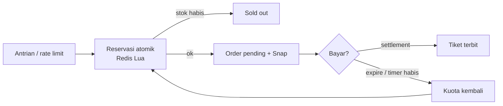

# 03 · War tiket: menahan lonjakan checkout

Prinsipnya: puluhan ribu orang tidak boleh menyentuh database sekaligus. Saring di edge, potong kuota secara atomik di Redis, dan kerjakan sisanya secara asinkron.



## Yang sudah diimplementasikan

| Lapis | Implementasi | File |
| --- | --- | --- |
| Reservasi atomik | Skrip Lua: cek batas per akun, cek & kurangi stok, simpan hold ber-TTL — dalam satu operasi | `checkout/lua/reserve.lua` |
| Nol oversell | Tes: 1.000 goroutine berebut 50 slot → tepat 50 sukses | `checkout/inventory_test.go` |
| Pengembalian kuota | Hold kedaluwarsa (indeks ZSET) & order expired dikembalikan worker tiap 15 detik, grace 2 menit | `worker/worker.go`, `lua/release.lua` |
| Bayar telat | `confirm.lua`: hold masih aktif → kunci; sudah lepas tapi stok ada → ambil ulang; stok habis → order `needs_refund` | `lua/confirm.lua` |
| Idempotensi | `Idempotency-Key` per order, `reservation_id` unik, webhook unik per `(order, status)`, jurnal unik per order | `checkout/handler.go`, migrasi |
| Asinkron | Tiket, ledger, email dikerjakan worker dari tabel outbox | `payment/webhook.go`, `worker/` |
| Pre-warm stok | Stok dimuat ke Redis sejak 30 menit sebelum penjualan dibuka (`SETNX`, tidak pernah menimpa) | `checkout/sync.go` |
| Cache baca | Info kategori di-cache 3 detik di memori API | `checkout/handler.go` |
| Cluster-ready | Semua key satu kategori memakai hash tag `{cat:<id>}` agar berada di slot Redis Cluster yang sama | `checkout/inventory.go` |

## Belum dibuat (urut prioritas)

1. **Virtual waiting room**: Redis ZSET antrian + token HMAC sekali pakai. Halaman tunggu statis dari CDN, polling posisi dengan jitter.
2. **Turnstile** di tombol Daftar + rate limit per IP / akun / NIK.
3. **Ballot** untuk event super-favorit (undian, tanpa lonjakan).
4. Circuit breaker ke Midtrans; feature flag untuk menutup penjualan darurat.

## Kunci Redis per kategori

| Key | Isi |
| --- | --- |
| `{cat:<id>}:stock` | Sisa stok |
| `{cat:<id>}:user:<uid>` | Jumlah slot yang dipegang user (batas per akun) |
| `{cat:<id>}:holds` | ZSET reservasi aktif, skor = waktu kedaluwarsa |
| `{cat:<id>}:hold:<rid>` | `"<uid>\|<qty>"` |
| `{cat:<id>}:confirmed:<rid>` | Penanda sudah dikonfirmasi (idempotensi) |
| `inventory:categories` | SET kategori yang dipantau worker |

Redis dijalankan dengan `appendonly yes` dan `noeviction` agar kuota tidak hilang atau terbuang saat memori penuh. Bila data Redis tetap hilang, `SyncCategory` menghitung ulang stok = kuota − slot order pending/lunas.

## Mengukur

```bash
make db-reset
make loadtest                                  # default 500 req/detik ke kategori 21K (kuota 200)
k6 run -e RATE=2000 loadtest/war-tiket.js      # naikkan bertahap
```

Threshold k6: `reserved_ok <= kuota`, tidak ada error tak terduga, p95 reservasi < 300 ms. Hasil uji di laptop/VM kecil wajar lebih lambat; yang tidak boleh gagal adalah kebenaran data (oversell = 0).

Uji pembanding saat scaffolding (satu container kecil, klien & server di mesin yang sama): 3.000 request dari 300 koneksi serentak ke kuota 200 → **200 sukses, 2.800 sold out, 0 error**, p95 ±340 ms.
