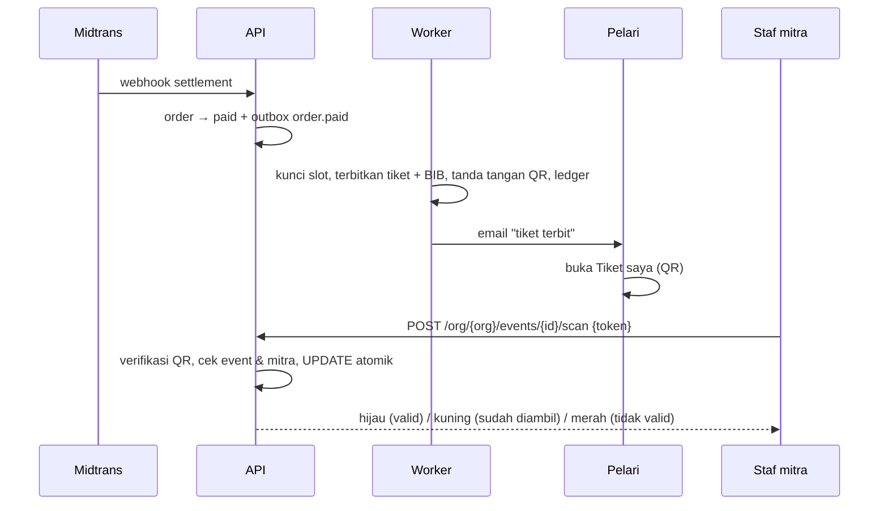
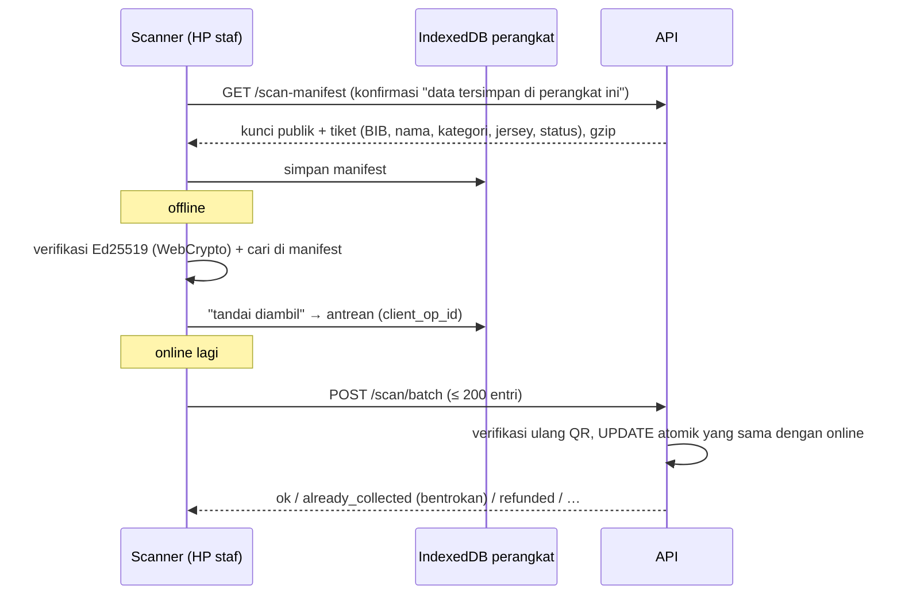

# 05 · Tiket QR dan scan race pack

Begitu pembayaran lunas, worker menerbitkan satu tiket ber-QR per peserta. QR hanya bisa ditandai "sudah diambil" oleh staf yang login sebagai anggota mitra pemilik event, dari halaman scanner di web yang sama.



## Isi QR

```
v1.<ticket_id>.<event_id>.<signature Ed25519, base64url>
```

- Tidak berisi data pribadi.
- Ditandatangani kunci privat server (`QR_PRIVATE_KEY`, buat dengan `make keygen`). Kunci publik tersedia di `GET /v1/qr/public-key` sehingga scanner bisa memverifikasi saat offline.
- Mengganti satu karakter ID membuat signature gagal (diuji di `ticket/qr_test.go`).

## Penerbitan (`ticket.IssueForOrder`)

- Idempotent: `tickets.participant_id` unik, jadi pemrosesan ulang tidak membuat tiket dobel.
- Nomor BIB berurutan per kategori: `bib_prefix` + 4 digit (5K → `50001`, 21K → `210001`), dialokasikan dengan `UPDATE … RETURNING` yang mengunci baris kategori di dalam transaksi.

## Scan (`ticket.Handler.Scan`)

Urutan pemeriksaan: signature QR valid → event di QR = event yang sedang di-scan → event milik mitra staf → lalu satu query atomik:

```sql
UPDATE tickets SET status = 'collected', collected_at = now(), collected_by = :staff
WHERE id = :ticket AND event_id = :event AND org_id = :org AND status = 'issued'
```

Hanya scan pertama yang mengubah baris. Scan kedua mendapat `already_collected` beserta waktu dan nama staf yang menandai.

| Hasil | Arti | Tampilan |
| --- | --- | --- |
| `ok` | Valid, belum diambil | Hijau: nama, kategori, BIB, ukuran jersey |
| `already_collected` | Sudah diambil | Kuning: kapan & oleh siapa |
| `invalid`, `wrong_event`, `not_found`, `refunded`, `cancelled` | Tolak | Merah + alasan |

Fitur pendukung di UI scanner: kamera via `@zxing/browser` (jalan di Chrome, Safari iOS, Firefox; butuh HTTPS/localhost), kolom "diwakilkan oleh", pencarian manual (nama, BIB, 4 digit akhir NIK) untuk pelari yang HP-nya mati, dan progres "diambil X dari Y" (saat offline siap: dari data perangkat + antrean).

Staf race pack bergabung lewat **undangan email** dari owner/admin (tab Tim): tautan sekali pakai, berlaku 7 hari, harus diterima dengan akun ber-email sama (lihat docs/07-api.md).

Setiap scan dicatat di `scan_logs` (`source = online`; scan offline yang disinkron: `offline_sync` beserta `client_op_id`, `device_id`, `scanned_at_device`).

## Scanner offline

Meja race pack sering tanpa sinyal stabil. Scanner punya dua keadaan: **Online** (perilaku di atas, tidak berubah) dan **Offline-siap**.



1. **Siapkan** (saat online, owner/admin/staf race pack): tombol *Siapkan mode offline* dengan peringatan bahwa nama peserta akan tersimpan di perangkat. Manifest berisi `ticket_id`, BIB, nama, kategori, ukuran jersey, status (+ kapan/oleh siapa bila sudah diambil). **Tanpa** email, nomor identitas, telepon, kontak darurat, tanggal lahir, atau data pembayaran. Berlaku `SCAN_MANIFEST_TTL_HOURS` (bawaan 24 jam). *Perbarui data* mengambil perubahan saja (`?since=<version>`: tiket diambil perangkat lain, refund, tiket baru).
2. **Scan**: setelah siap, scanner selalu memverifikasi di perangkat lebih dulu (rata-rata beberapa milidetik, juga dengan 10.000 tiket): tanda tangan QR dengan kunci publik dari manifest (WebCrypto `Ed25519`; tidak ada kripto buatan sendiri), event cocok, lalu status di manifest. Hasil sama dengan online (hijau `ok`, kuning `already_collected`, merah `invalid`/`wrong_event`/`not_found`/`refunded`/`cancelled`), ditambah kuning **"Tidak ada di daftar offline"** untuk QR sah yang tiketnya terbit setelah manifest diunduh: tidak ditandai, staf diminta menyambungkan internet atau mencari manual. Pencarian manual offline memakai nama dan BIB saja (4 digit akhir NIK tidak ikut diunduh).
3. **Antrean**: tiap "tandai diambil" disimpan di IndexedDB (`client_op_id` UUID, `ticket_id`, jam perangkat, `device_id` acak per instalasi, staf, "diwakilkan oleh", status `pending|synced|conflict|rejected`) dan tiketnya langsung dianggap diambil di perangkat itu. Antrean bertahan walau tab ditutup.
4. **Sinkron** otomatis saat online kembali dan tiap 30 detik selama ada antrean (backoff sampai 5 menit bila gagal), plus tombol *Sinkronkan sekarang*. Server idempoten per `client_op_id` (indeks unik di `scan_logs`: kirim ulang = hasil sama, tanpa efek ganda), memverifikasi ulang QR (tidak percaya klien), dan memakai `UPDATE … WHERE status = 'issued'` yang sama dengan scan online. `collected_at` = jam server saat diproses; jam perangkat hanya disimpan (`scanned_at_device`) dan tidak memengaruhi keputusan. Selisih jam perangkat > 5 menit ditampilkan sebagai peringatan. Kegagalan jaringan tidak menghapus antrean; penolakan permanen (mis. 403 karena peran dicabut) berhenti dicoba dan ditampilkan.
5. **Bentrokan**: dua perangkat offline menandai tiket yang sama → yang lebih dulu **diproses server** menang. Yang kedua mendapat `already_collected` dan masuk daftar **Perlu ditinjau** (nama, BIB, siapa & kapan lebih dulu menurut server). Tidak ada penggabungan otomatis yang menimpa; staf menutup entri setelah meninjau.

### Keamanan data di perangkat

- Manifest dihapus saat **logout**, saat **berganti akun** di perangkat yang sama, saat **kedaluwarsa** (scan offline berhenti dengan pesan dan meminta unduh ulang; data basi berisiko menerima tiket yang sudah di-refund), dan lewat tombol *Hapus data offline*. Antrean yang belum terkirim dipertahankan sampai terkirim atau dibuang manual dengan konfirmasi (antrean milik akun lain tidak dikirim atas nama akun yang sedang masuk).
- **Batasan jujur**: IndexedDB tidak dienkripsi aplikasi. Perangkat yang hilang atau dipinjam orang lain berisiko membocorkan nama + BIB peserta sampai masa berlaku habis. Mitigasi di atas hanya mengurangi risiko; pakai perangkat panitia dengan kunci layar. Enkripsi dengan PIN ada di roadmap.
- IndexedDB yang tidak tersedia/diblokir/penuh: pesan jelas, mode offline mati, scan online tetap jalan. Peramban tanpa WebCrypto `Ed25519` (lebih lama dari Chrome/Edge 137, Safari 17, Firefox 129) juga tidak bisa memakai mode offline; tidak ada pustaka cadangan.

### Memuat ulang tanpa internet (keputusan: tidak didukung)

Service worker yang meng-cache halaman scanner + aset `/_next/static` sudah dicoba. HTML dan aset ter-cache dengan benar, tetapi Next.js 16 (`cacheComponents`) meminta payload RSC halaman itu sendiri (`?_rsc=…`, header `Next-Router-Segment-Prefetch: /_full`) setiap kali dimuat ulang. Payload yang di-cache dengan meniru header router internal membuat hidrasi gagal (`Cannot read properties of undefined (reading '0')`). Itu bergantung pada protokol internal Next yang bisa berubah antar versi, jadi tidak dipakai. Yang berlaku:

- Selama mode offline siap, panel scanner menampilkan peringatan merah **"Jangan muat ulang atau menutup halaman ini saat offline"**, dan saat offline peramban meminta konfirmasi (`beforeunload`) sebelum memuat ulang/menutup tab.
- Bila tab tetap tertutup saat offline, halaman baru bisa dibuka lagi setelah ada internet; antrean tetap utuh di IndexedDB dan langsung dikirim.

## Rencana berikutnya

- QR dinamis (berganti tiap 30 detik) di hari-H agar screenshot tidak bisa dipakai.
- Enkripsi data offline dengan PIN; halaman scanner yang bisa dimuat ulang tanpa internet (perlu dukungan resmi Next.js untuk offline).

## Absen hari-H

Pengambilan race pack tidak membuktikan peserta ikut lari. Mode scanner **Absen hari-H** (pemilih mode di halaman scanner, dengan penanda besar mode aktif; mode terakhir diingat per event) menandai kehadiran di lokasi lomba: `POST …/attend` (`{token}` atau `{ticket_id}`) mengubah `tickets.attended_at/attended_by` secara atomik (`WHERE status IN ('issued','collected') AND attended_at IS NULL`), tanpa menyentuh `status`/`collected_*`. Hasil: hijau `ok`, kuning `already_attended` (kapan dan oleh siapa), merah `invalid`/`wrong_event`/`not_found`/`refunded`/`cancelled`. Tercatat di `scan_logs` (`kind = 'attend'`; baris lama `collect`).

- **Jendela waktu**: bawaan tanggal lomba (WIB) sampai akhir hari berikutnya; di luar itu 409 `attend_not_open`. Owner/admin dapat menimpa `attendance_opens_at/closes_at` (halaman Undian atau `PUT …/attendance/settings`).
- **Pembatalan** (salah scan): `POST …/attend/cancel` `{ticket_id, reason 5–300}`, owner/admin saja, audit `attendance.cancelled`; 409 `attendance_in_use` bila tiket pemenang undian aktif.
- **Offline**: manifest memuat `attended` (+ `attended_at`) per tiket, antrean lokal punya `kind` (`collect|attend`), `POST …/scan/batch` menerima `kind` per entri (bawaan `collect`), tetap idempoten per `client_op_id`. Dua perangkat memindai tiket yang sama: satu `ok`, satu `already_attended` masuk "Perlu ditinjau". Jendela absen dinilai dengan `scanned_at` perangkat saat sinkron. `?since=` menyertakan perubahan absen. Mode ambil race pack tidak berubah.
- Halaman Peserta: kolom Hadir, filter Hadir/Belum hadir, ringkasan per kategori; CSV peserta punya kolom "Hadir hari-H (waktu)". Absen menjadi dasar kolam undian ([12](12-undian.md)).
