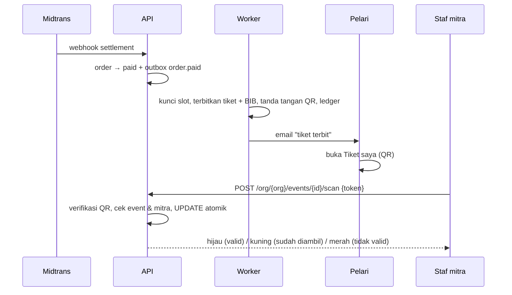

# 05 · Tiket QR dan scan race pack

Begitu pembayaran lunas, worker menerbitkan satu tiket ber-QR per peserta. QR hanya bisa ditandai "sudah diambil" oleh staf yang login sebagai anggota mitra pemilik event, dari halaman scanner di web yang sama.



## Isi QR

```
v1.<ticket_id>.<event_id>.<signature Ed25519, base64url>
```

- Tidak berisi data pribadi.
- Ditandatangani kunci privat server (`QR_PRIVATE_KEY`, buat dengan `make keygen`). Kunci publik tersedia di `GET /v1/qr/public-key` sehingga scanner bisa memverifikasi saat offline.
- Mengganti satu karakter ID membuat signature gagal (diuji di `ticket/qr_test.go`).

## Penerbitan (`ticket.IssueForOrder`)

- Idempotent: `tickets.participant_id` unik, jadi pemrosesan ulang tidak membuat tiket dobel.
- Nomor BIB berurutan per kategori: `bib_prefix` + 4 digit (5K → `50001`, 21K → `210001`), dialokasikan dengan `UPDATE … RETURNING` yang mengunci baris kategori di dalam transaksi.

## Scan (`ticket.Handler.Scan`)

Urutan pemeriksaan: signature QR valid → event di QR = event yang sedang di-scan → event milik mitra staf → lalu satu query atomik:

```sql
UPDATE tickets SET status = 'collected', collected_at = now(), collected_by = :staff
WHERE id = :ticket AND event_id = :event AND org_id = :org AND status = 'issued'
```

Hanya scan pertama yang mengubah baris. Scan kedua mendapat `already_collected` beserta waktu dan nama staf yang menandai. Setiap scan dicatat di `scan_logs`.

| Hasil | Arti | Tampilan |
| --- | --- | --- |
| `ok` | Valid, belum diambil | Hijau: nama, kategori, BIB, ukuran jersey |
| `already_collected` | Sudah diambil | Kuning: kapan & oleh siapa |
| `invalid`, `wrong_event`, `not_found`, `refunded`, `cancelled` | Tolak | Merah + alasan |

Fitur pendukung di UI scanner: kamera via `@zxing/browser` (jalan di Chrome, Safari iOS, Firefox; butuh HTTPS/localhost), kolom "diwakilkan oleh", pencarian manual (nama, BIB, 4 digit akhir NIK) untuk pelari yang HP-nya mati, dan progres "diambil X dari Y".

## Rencana berikutnya

- Mode offline penuh: unduh daftar tiket ke IndexedDB, verifikasi dengan kunci publik, antrekan hasil, sinkron saat online.
- QR dinamis (berganti tiap 30 detik) di hari-H agar screenshot tidak bisa dipakai.
- Undang staf RPC lewat email dari dashboard mitra.
