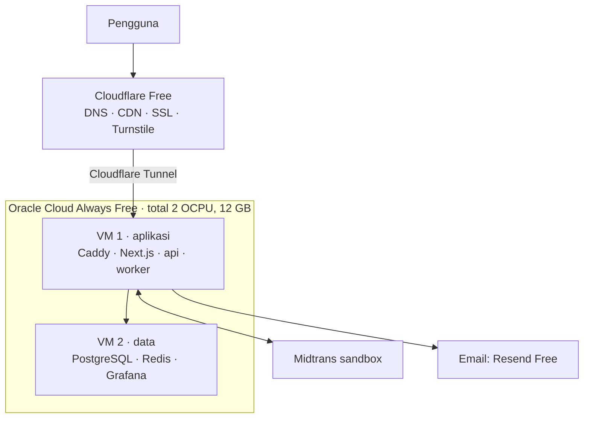

# 06 · Infra gratis (Rp0)

Arsitektur dan kode sama dengan versi produksi; hanya tempat menjalankannya yang gratis. Komponen yang menanggung beban war tiket di-self-host di VM gratis (tanpa kuota per request); layanan hosted gratis dipakai untuk hal ringan saja.

| Komponen | Pilihan gratis | Batas yang perlu diingat |
| --- | --- | --- |
| Compute | Oracle Cloud Always Free, Ampere A1 dibagi 2 VM | Total 2 OCPU & 12 GB sejak 2026; daftar butuh kartu untuk verifikasi; jangan upgrade ke Pay As You Go tanpa sengaja |
| Edge | Cloudflare Free + Tunnel | Aset statis gratis tanpa batas; Workers Free hanya 100.000 request/hari (jangan taruh waiting room di Workers) |
| Database / Redis | Self-host (Docker) di VM 2 | Neon/Upstash free tier punya kuota bulanan yang bisa habis dalam satu war tiket |
| Email | Mailpit (lokal), Resend Free (online) | Resend Free 100 email/hari |
| Pembayaran | Midtrans sandbox | Tanpa uang sungguhan |
| CI | GitHub Actions | Gratis untuk repo publik |

Batas free tier sering berubah — cek ulang sebelum deploy.

## Langkah deploy (garis besar)

1. Buat 2 VM Ampere A1 (1 OCPU, 6 GB masing-masing, Ubuntu 24.04) di satu VCN; buka port 5432/6379 hanya untuk subnet privat.
2. VM 2: pasang Docker, jalankan Postgres + Redis (bisa memakai `docker-compose.yml` repo ini tanpa Mailpit), set password.
3. VM 1: build image `backend/Dockerfile` dan frontend (`npm run build && npm start`), atau jalankan binary langsung via systemd.
4. Isi `.env` produksi: `APP_ENV=production`, `AUTO_VERIFY_ORGS=false`, `UPLOAD_DIR` ke disk persisten (lihat di bawah), `TRUSTED_PROXY_HOPS=1` (lihat di bawah), `QR_PRIVATE_KEY` dari `make keygen`, `DATABASE_URL`/`REDIS_ADDR` ke IP privat VM 2, SMTP Resend.
5. `cloudflared tunnel` dari VM 1 ke domain kamu (`racego.example` → web :3000, `api.racego.example` → :8080). Tidak perlu membuka port publik.
6. Arahkan Notification URL Midtrans sandbox ke `https://api.racego.example/v1/webhooks/midtrans`.

> Penting: di `APP_ENV` selain `development`, header `X-User-ID` diabaikan. Login memakai email + kode OTP (lihat [07-api](07-api.md)).

### Gambar unggahan (`UPLOAD_DIR`)

Poster & logo mitra disimpan sebagai file di `UPLOAD_DIR` (default `./data/uploads` relatif ke folder backend). Di VM, arahkan ke **disk persisten** (mis. block volume `/srv/racego/uploads`, bukan folder sementara / layer container) dan masukkan ke **backup** bersama dump Postgres: DB hanya menyimpan path-nya, jadi kehilangan folder ini = poster & logo rusak. Nama file = hash isi, jadi aman di-cache Cloudflare selamanya.

### IP klien di belakang proxy (`TRUSTED_PROXY_HOPS`)

Batas permintaan kode OTP per IP butuh IP klien yang asli. Header `X-Forwarded-For` bisa diisi siapa saja, jadi API hanya memercayainya sesuai `TRUSTED_PROXY_HOPS`:

| Nilai | Kapan | IP klien diambil dari |
| --- | --- | --- |
| `0` (bawaan) | API diakses langsung (laptop, uji k6 tanpa proxy) | Alamat koneksi TCP; `X-Forwarded-For`/`X-Real-IP` diabaikan |
| `1` | Cloudflare Tunnel langsung ke :8080 | `CF-Connecting-IP` (ditimpa Cloudflare), atau entri paling kanan `X-Forwarded-For` |
| `2` | Cloudflare → Caddy → API | `CF-Connecting-IP`, atau entri kedua dari kanan `X-Forwarded-For` |

Pasang nilai > 0 hanya bila port API **tidak** bisa dicapai selain lewat proxy tersebut (dengan Tunnel tidak ada port publik). Kalau proxy-nya bukan Cloudflare, pastikan proxy itu menghapus header `CF-Connecting-IP` dari klien.

## Uji beban di infra gratis

Jalankan k6 langsung ke VM/laptop, **bukan** lewat Cloudflare, agar tidak terkena rate limit atau melanggar ketentuan layanan. Gunakan mode mock Midtrans saat uji beban. Naikkan bertahap (5 ribu → 10 ribu → 50 ribu VU) dan catat titik jenuhnya; yang boleh menurun adalah latensi, bukan kebenaran data.
