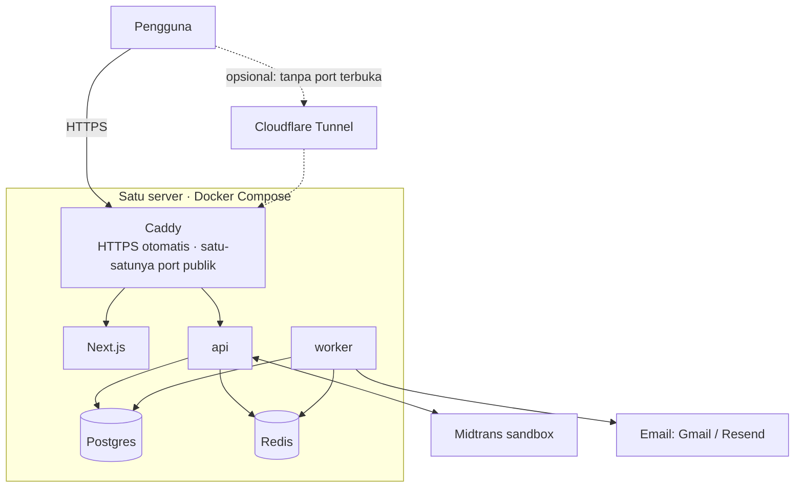

# 06 · Infra gratis (Rp0)

Arsitektur dan kode sama dengan versi produksi; hanya tempat menjalankannya yang gratis. Komponen yang menanggung beban war tiket di-self-host (tanpa kuota per request); layanan hosted gratis dipakai untuk hal ringan saja.

Satu server Linux dengan Docker menjalankan seluruh stack (Caddy, Next.js, api, worker, Postgres, Redis) lewat `docker-compose.prod.yml`. Tidak perlu dua VM: batas memori semua container dijumlah sekitar 3 GB, jadi muat di mesin 2 CPU / 4 GB. Langkah lengkapnya ada di **[10-deploy.md](10-deploy.md)**.

| Komponen | Pilihan gratis | Batas yang perlu diingat |
| --- | --- | --- |
| Compute | Server Linux mana pun dengan Docker: Oracle Cloud Always Free, VPS murah, atau laptop (`make demo`) | Lihat bagian "Di mana menjalankannya" di [10-deploy](10-deploy.md#9-di-mana-menjalankannya) |
| HTTPS & alamat | Caddy + Let's Encrypt; alamat dari DuckDNS atau domain sendiri | Port 80/443 harus terbuka agar sertifikat terbit |
| Edge (opsional) | Cloudflare Tunnel: quick tunnel untuk demo, tunnel bernama untuk server tanpa port terbuka | Quick tunnel: alamat berubah tiap dinyalakan, maks 200 request bersamaan, tanpa jaminan uptime |
| Database / Redis | Self-host di server yang sama (volume Docker) | Neon/Upstash free tier punya kuota bulanan yang bisa habis dalam satu war tiket |
| Email | Mailpit (lokal), Gmail App Password atau Resend Free (online) | Resend Free 100 email/hari |
| Pembayaran | Midtrans sandbox, atau mode mock | Tanpa uang sungguhan |
| CI | GitHub Actions (`.github/workflows/ci.yml`) | Gratis untuk repo publik |

Batas free tier sering berubah; cek ulang sebelum deploy.

### Gambar unggahan (`UPLOAD_DIR`)

Di stack produksi, poster & logo disimpan di volume Docker `uploads` (`UPLOAD_DIR=/data/uploads`, hanya dipasang di `api`) dan ikut `make backup`. DB hanya menyimpan path-nya, jadi kehilangan volume ini berarti poster & logo rusak; jangan `down -v`. Nama file = hash isi, jadi aman di-cache selamanya.

### IP klien di belakang proxy (`TRUSTED_PROXY_HOPS`)

Batas permintaan kode OTP per IP butuh IP klien yang asli. `X-Forwarded-For` bisa diisi siapa saja, jadi API hanya memercayainya sesuai `TRUSTED_PROXY_HOPS`:

| Nilai | Kapan | IP klien diambil dari |
| --- | --- | --- |
| `0` (bawaan development) | API diakses langsung (laptop, uji k6 tanpa proxy) | Alamat koneksi TCP; `X-Forwarded-For`/`X-Real-IP` diabaikan |
| `1` (stack produksi) | Caddy di depan API, langsung atau di belakang Cloudflare Tunnel | `CF-Connecting-IP` bila ada, selain itu entri paling kanan `X-Forwarded-For` |

Tabel topologi lengkap (`PROXY_MODE`, siapa yang membuang/menimpa header) ada di [10-deploy](10-deploy.md#ip-klien-proxy_mode-dan-trusted_proxy_hops). Pasang nilai > 0 hanya bila API **tidak** bisa dicapai selain lewat proxy tersebut.

## Uji beban di infra gratis

Jalankan k6 langsung ke server/laptop, **bukan** lewat Cloudflare (quick tunnel juga membatasi 200 request bersamaan), agar tidak terkena rate limit atau melanggar ketentuan layanan. Gunakan mode mock Midtrans saat uji beban. Naikkan bertahap (5 ribu → 10 ribu → 50 ribu VU) dan catat titik jenuhnya; yang boleh menurun adalah latensi, bukan kebenaran data.
