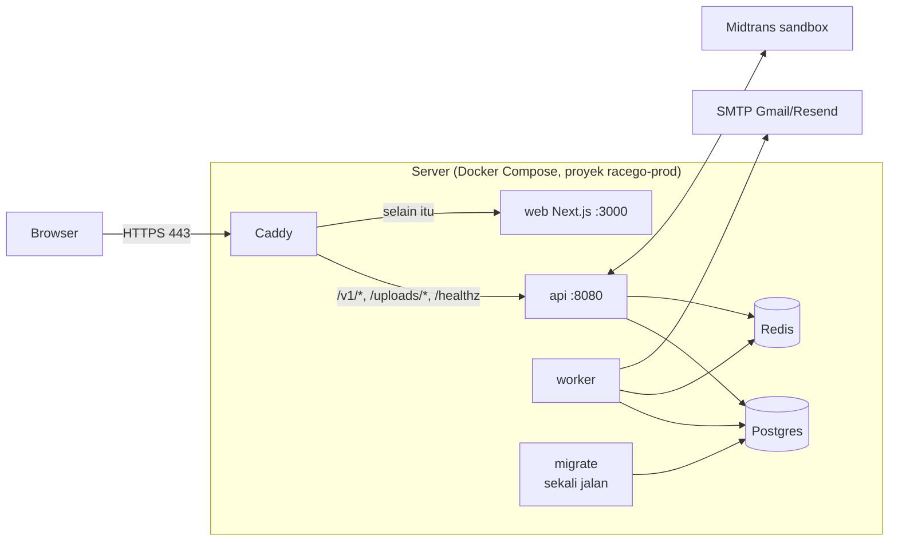

# 10 · Deploy ke server (dan demo dari laptop)

Panduan ini untuk yang belum pernah deploy. Hasil akhirnya: RaceGo berjalan di **satu server Linux mana pun yang punya Docker**, dengan HTTPS otomatis di satu alamat web. Semua bagiannya gratis kecuali servernya sendiri, dan untuk demo singkat servernya bisa laptopmu (`make demo`).



Yang perlu kamu tahu:

- **Satu pintu masuk.** Hanya Caddy yang membuka port (80/443). Postgres, Redis, api, worker, dan web hanya bisa saling bicara di jaringan internal Docker.
- **Satu origin.** Browser memanggil API di alamat yang sama (`/v1/...`), jadi tidak ada urusan CORS atau cookie lintas domain. Image frontend di-build dengan `NEXT_PUBLIC_API_URL=""`, sehingga image yang sama bisa dipakai di alamat mana pun.
- **Semua rahasia ada di `.env.prod`.** File ini di-ignore Git; contohnya ada di `.env.prod.example`.
- **Perintahnya ada di Makefile** (`make help`): `prod-up`, `prod-down`, `prod-logs`, `prod-migrate`, `prod-seed`, `prod-grant`, `prod-verify`, `backup`, `restore`, `demo`, `demo-down`.

## 1. Siapkan server

**Spesifikasi.** Ubuntu 24.04 atau Debian 12, 2 CPU, RAM 4 GB atau lebih (batas memori semua container dijumlah sekitar 3 GB), disk 20 GB.

**Buat user non-root dan pasang kunci SSH.** Jalankan di laptop, lalu di server sebagai root:

```bash
# di laptop: buat kunci bila belum punya, lalu salin ke server
ssh-keygen -t ed25519
ssh-copy-id root@IP_SERVER

# di server (sebagai root): user baru dengan sudo, pakai kunci yang sama
adduser racego
usermod -aG sudo racego
rsync --archive --chown=racego:racego ~/.ssh /home/racego
```

Setelah bisa `ssh racego@IP_SERVER`, matikan login root dan password. Di `/etc/ssh/sshd_config`, set `PermitRootLogin no` dan `PasswordAuthentication no`, lalu jalankan `sudo systemctl restart ssh`.

**Pasang Docker dan Compose plugin.** Ikuti [docs.docker.com/engine/install/ubuntu](https://docs.docker.com/engine/install/ubuntu/) (atau `/debian/`), lalu:

```bash
sudo usermod -aG docker racego   # keluar lalu SSH lagi agar berlaku
docker compose version           # harus v2.x atau lebih baru
sudo apt install -y make git
```

**Firewall: hanya 22, 80, 443.**

```bash
sudo ufw default deny incoming
sudo ufw allow 22/tcp
sudo ufw allow 80/tcp
sudo ufw allow 443/tcp
sudo ufw allow 443/udp     # HTTP/3, opsional
sudo ufw enable
```

> Port yang dibuka Docker (`ports:`) melewati aturan `ufw`. Karena itu hanya Caddy yang punya `ports:` di `docker-compose.prod.yml`. Jangan menambah `ports:` ke service lain.

Kalau penyedia server punya firewall sendiri (security list, security group), buka juga 80 dan 443 di sana.

**Update keamanan otomatis:**

```bash
sudo apt install -y unattended-upgrades
sudo dpkg-reconfigure -plow unattended-upgrades
```

## 2. Dapatkan alamat web

Sertifikat HTTPS dari Let's Encrypt baru bisa terbit bila alamatnya mengarah ke IP server **dan** port 80/443 terbuka dari internet. Pilih salah satu:

- **DuckDNS (gratis).** Masuk di [duckdns.org](https://www.duckdns.org), buat subdomain (mis. `racego-kamu`), lalu isi kolom *current ip* dengan IP publik server. Hasilnya `racego-kamu.duckdns.org`. Untuk IP yang bisa berubah, lihat [duckdns.org/install.jsp](https://www.duckdns.org/install.jsp) (cron pembaru IP).
- **Domain sendiri.** Di pengelola DNS, buat **A record** `racego.domainkamu.com` → IP server (dan **AAAA** bila server punya IPv6).

Cek dari laptop: `dig +short racego-kamu.duckdns.org` harus menampilkan IP server.

## 3. Pasang RaceGo

```bash
git clone https://github.com/gavinadlan/racego.git
cd racego
cp .env.prod.example .env.prod
scripts/gen-secrets.sh
```

`gen-secrets.sh` mengisi `POSTGRES_USER`, `POSTGRES_PASSWORD`, `REDIS_PASSWORD`, dan `QR_PRIVATE_KEY` dengan nilai acak, tanpa mencetaknya. Nilai yang sudah terisi tidak akan ditimpa tanpa konfirmasi.

> **Kunci QR jangan pernah berubah.** `QR_PRIVATE_KEY` menandatangani QR setiap tiket. Kalau diganti, semua tiket yang sudah terbit ditolak scanner. Salin `.env.prod` (minimal kunci ini) ke pengelola password **sekarang**. Kehilangan file ini sama dengan kehilangan tiket.

Buka `.env.prod` (`nano .env.prod`) dan isi:

| Variabel | Isi |
| --- | --- |
| `SITE_ADDRESS` | Alamat dari langkah 2, tanpa `https://` (mis. `racego-kamu.duckdns.org`) |
| `SMTP_ADDR`, `SMTP_USERNAME`, `SMTP_PASSWORD`, `MAIL_FROM` | **Gmail:** `smtp.gmail.com:587`, alamat Gmail, dan [App Password](https://support.google.com/accounts/answer/185833) (bukan password akun; butuh verifikasi 2 langkah). **Resend:** `smtp.resend.com:587`, user `resend`, password = API key. Tanpa SMTP, kode masuk tidak terkirim. |
| `MIDTRANS_SERVER_KEY`, `MIDTRANS_CLIENT_KEY` | Kunci **sandbox** dari [dashboard.sandbox.midtrans.com](https://dashboard.sandbox.midtrans.com) (*Settings → Access Keys*). Kosongkan keduanya untuk mode mock: tombol "Simulasikan bayar" muncul. `MIDTRANS_IS_PRODUCTION` tetap `false`. |
| `AUTO_VERIFY_ORGS` | `false` (default aman): penyelenggara baru harus diverifikasi manual sebelum bisa menerbitkan event. Untuk demo boleh `true`. |

`FRONTEND_URL` tidak perlu diisi; nilainya otomatis `https://$SITE_ADDRESS`. Pengaturan produksi lain sudah dipasang di `docker-compose.prod.yml`: `APP_ENV=production`, dev login mati, dan `UPLOAD_DIR=/data/uploads` di volume.

Nyalakan:

```bash
make prod-up
```

Perintah ini membangun image, menjalankan migrasi (service `migrate` harus sukses sebelum `api`/`worker` start), dan menunggu semua service sehat. Build pertama makan waktu beberapa menit. Buka `https://SITE_ADDRESS`; Caddy mengurus sertifikat sendiri pada akses pertama.

**Data contoh (opsional, untuk demo).** `make prod-seed` mengisi 5 penyelenggara dan 17 event. Dua hal perlu diingat:

- Tanggal race dan penjualan dihitung **relatif terhadap hari seed dijalankan**, jadi lama-lama event contoh menjadi arsip.
- Seed **tidak menyegarkan** data yang sudah ada; menjalankannya lagi tidak memperbarui tanggal event lama.

**Jadikan akunmu pemilik penyelenggara.** Masuk sekali lewat web (email + kode), lalu:

```bash
make prod-grant EMAIL=kamu@gmail.com ORG=jakarta-runners ROLE=owner   # bila memakai data contoh
make prod-verify ORG=slug-penyelenggara                               # izinkan menerbitkan event
```

Penyelenggara yang mendaftar sendiri lewat **Jadi penyelenggara** tetap berstatus *menunggu verifikasi* sampai kamu menjalankan `make prod-verify ORG=<slug>`. Slug terlihat di alamat dashboard `/org/<slug>`.

## 4. Midtrans: Notification URL

Di dashboard sandbox Midtrans, buka *Settings → Configuration*, lalu isi **Payment Notification URL** dengan:

```
https://SITE_ADDRESS/v1/webhooks/midtrans
```

Uji: beli tiket, bayar dengan simulator sandbox Midtrans, lalu pastikan tiket muncul di **Tiket saya**. Kalau webhook tidak sampai, order tetap terbayar karena halaman order dan worker (tiap menit) mengecek status langsung ke Midtrans. Webhook hanya mempercepat.

## 5. Operasional sehari-hari

| Kebutuhan | Perintah |
| --- | --- |
| Update ke versi terbaru | `git pull && make prod-up` |
| Lihat status | `docker compose -f docker-compose.prod.yml --env-file .env.prod ps` |
| Lihat log (semua / satu service) | `make prod-logs` / `make prod-logs S=api` |
| Restart satu service | `docker compose -f docker-compose.prod.yml --env-file .env.prod restart api` |
| Matikan (data tetap) | `make prod-down` |
| Bersihkan image lama | `docker image prune -f` (sekali-sekali: `docker builder prune -f`) |

**Rollback ke commit sebelumnya:**

```bash
git log --oneline -5            # cari commit yang mau dipakai
git checkout <commit>
make prod-up
# kembali ke versi terbaru nanti: git checkout main && make prod-up
```

Migrasi database hanya bergerak maju. Kalau commit yang di-rollback menambah migrasi, kolom/tabel barunya tetap ada; versi lama biasanya mengabaikannya. Bila ragu, backup dulu.

Log container berotasi otomatis (`json-file`, 3 × 10 MB per service). Semua service punya healthcheck dan `restart: unless-stopped`, jadi container yang crash dinyalakan ulang sendiri, termasuk setelah server reboot.

## 6. Backup dan restore

`make backup` menyimpan `pg_dump -Fc` dan arsip volume `uploads` ke `backups/racego-YYYYMMDD-HHMMSS/`. Hanya 7 backup terakhir yang disimpan (ubah dengan `KEEP=14 make backup`). Kode keluarnya bukan nol bila gagal, jadi aman dipanggil cron.

**Terjadwal tiap malam pukul 02.30:** jalankan `crontab -e`, lalu tambahkan:

```
30 2 * * * cd /home/racego/racego && make backup >> backups/backup.log 2>&1
```

**Salin ke luar server.** Backup di disk yang sama ikut hilang kalau server hilang. Contoh tarik dari laptop:

```bash
rsync -a racego@IP_SERVER:racego/backups/ ~/racego-backups/
```

Simpan `.env.prod` terpisah dari backup (di pengelola password). Backup tanpa kunci QR yang sama membuat QR tiket lama tidak sah.

**Restore** ke stack yang sedang berjalan (juga di server baru setelah `make prod-up` dengan `.env.prod` yang sama):

```bash
make restore FILE=backups/racego-20261028-023000
```

Skrip meminta kamu mengetik `PULIHKAN`. Setelah itu skrip menghentikan api/worker, mengganti database dan unggahan, mengosongkan Redis (stok dimuat ulang dari database), lalu menyalakan api/worker lagi. Order *pending* yang sedang berjalan saat backup dibuat bisa tidak mengembalikan slotnya saat kedaluwarsa; jalankan restore saat tidak ada penjualan berlangsung.

## 7. Checklist sebelum dibuka ke publik

- [ ] `https://SITE_ADDRESS` terbuka dengan gembok hijau, dan `http://` dialihkan ke `https://`.
- [ ] Menu **Akun contoh (dev)** tidak ada; `curl -H 'X-User-ID: 11111111-1111-1111-1111-111111111111' https://SITE_ADDRESS/v1/me` → 401.
- [ ] `AUTO_VERIFY_ORGS=false` (kecuali memang demo).
- [ ] `QR_PRIVATE_KEY` baru dari `gen-secrets.sh` (bukan kunci dev), dan salinannya tersimpan di luar server.
- [ ] Password Postgres/Redis acak dari `gen-secrets.sh`; `.env.prod` hanya bisa dibaca pemiliknya (`ls -l .env.prod` → `-rw-------`).
- [ ] Hanya 22/80/443 terbuka: dari laptop, `nc -zv IP_SERVER 5432` dan `nc -zv IP_SERVER 6379` harus gagal.
- [ ] `PROXY_MODE` dan `TRUSTED_PROXY_HOPS` sesuai topologi (tabel di bawah), lalu `scripts/check-ip-spoof.sh https://SITE_ADDRESS emailmu@gmail.com` → LULUS. Skrip ini mengirim sampai 20 email kode ke `emailmu+ipcekN@…` dan memakai jatah kode IP-mu selama 1 jam.
- [ ] Update OS otomatis aktif, login SSH hanya dengan kunci.
- [ ] Backup cron terpasang, dan satu restore sudah pernah dicoba.

### IP klien: `PROXY_MODE` dan `TRUSTED_PROXY_HOPS`

Batas permintaan kode OTP per IP (20/jam) butuh IP klien yang asli. API hanya memercayai header IP dari proxy di depannya (`backend/internal/server/realip.go`).

| Topologi | `PROXY_MODE` | `CADDY_BIND` | `TRUSTED_PROXY_HOPS` | Yang mencegah pemalsuan |
| --- | --- | --- | --- | --- |
| (a) Browser → Caddy → API (server biasa) | `direct` | `0.0.0.0` | `1` | Caddy **membuang** `CF-Connecting-IP` dari klien dan **menimpa** `X-Forwarded-For` dengan IP koneksi (tanpa `trusted_proxies`). API membaca entri paling kanan = IP asli. |
| (b) Cloudflare Tunnel → Caddy → API (`make demo`, atau profile `tunnel`) | `tunnel` | `127.0.0.1` | `1` | `CF-Connecting-IP` diisi ulang oleh Cloudflare dan dipercaya API. Caddy hanya terjangkau dari mesin itu sendiri, jadi tidak ada jalan mengirim header palsu langsung ke Caddy. |

Jangan pernah memakai `PROXY_MODE=tunnel` dengan Caddy yang terbuka ke internet: siapa pun bisa mengirim `CF-Connecting-IP` palsu dan lolos dari batas per IP. `scripts/check-ip-spoof.sh` akan GAGAL pada konfigurasi itu.

### Opsional: server tanpa port terbuka (Cloudflare Tunnel bernama)

Kalau server tidak bisa membuka port 80/443 (mis. di belakang NAT) dan kamu punya domain di Cloudflare:

1. Buat tunnel di dasbor Cloudflare Zero Trust, lalu salin tokennya ke `TUNNEL_TOKEN`.
2. Arahkan hostname publik tunnel ke `http://caddy:80`.
3. Di `.env.prod`, isi `SITE_ADDRESS=:80`, `PROXY_MODE=tunnel`, `CADDY_BIND=127.0.0.1`, dan `FRONTEND_URL=https://hostname-kamu`.
4. Jalankan: `docker compose -f docker-compose.prod.yml --env-file .env.prod --profile tunnel up -d --build --wait`

## 8. Demo dari laptop: `make demo`

Untuk memamerkan RaceGo beberapa jam tanpa server:

```bash
brew install cloudflared                                  # sekali
cp .env.prod.example .env.prod && scripts/gen-secrets.sh  # sekali; isi SMTP agar bisa login
make demo
```

`make demo` melakukan langkah berikut:

1. Membuka [Cloudflare quick tunnel](https://developers.cloudflare.com/cloudflare-one/connections/connect-networks/do-more-with-tunnels/trycloudflare/) (gratis, tanpa akun, tanpa domain) ke Caddy lokal di `127.0.0.1:8088`.
2. Membaca URL `https://….trycloudflare.com` dari output cloudflared.
3. Menulis `.env.demo` (`SITE_ADDRESS=:80`, `FRONTEND_URL` = URL tunnel, `PROXY_MODE=tunnel`).
4. Menyalakan stack produksi.
5. Mengisi data contoh bila database masih kosong.
6. Menunggu `/healthz` lewat URL publik, lalu mencetak URL dan cara masuk.

Image frontend tidak di-build ulang walau URL berganti, karena panggilan API-nya relatif.

Hentikan dengan **Ctrl+C**, atau `make demo-down` dari terminal lain. Keduanya mematikan tunnel dan container, lalu menghapus `.env.demo`. Data tetap ada di volume.

Batasan quick tunnel:

- Alamatnya **berubah setiap demo dinyalakan**, jadi tautan di email lama ikut mati.
- Tidak ada jaminan uptime.
- Maksimal 200 request bersamaan; lebih dari itu mendapat 429. Jangan dipakai untuk uji beban.

## 9. Di mana menjalankannya

Tanpa janji. Batas layanan gratis sering berubah, jadi cek halaman resminya sebelum memilih. *Dicek terakhir: 28 Oktober 2026.*

| Pilihan | Catatan |
| --- | --- |
| **Oracle Cloud Always Free** ([daftar resource Always Free](https://docs.oracle.com/en-us/iaas/Content/FreeTier/freetier_topic-Always_Free_Resources.htm)) | Jatah Ampere A1 (ARM) per tenancy saat dicek: total 2 OCPU dan 12 GB RAM, cukup untuk stack ini (image backend & frontend bisa di-build di ARM). Pendaftaran dikenal menolak kartu virtual/prepaid. Oracle bisa **mereklamasi instance idle** (CPU, jaringan, dan memori di bawah ambang tertentu selama 7 hari); baca aturan persisnya di halaman tersebut. Buka port 80/443 juga di *security list* VCN. |
| **VPS murah mana pun** | Apa saja dengan Ubuntu/Debian, 2 CPU / 4 GB, IP publik. Ikuti panduan ini apa adanya. |
| **Laptop + `make demo`** | Gratis, untuk demo sementara. Mati ketika laptop tidur. |

## 10. Troubleshooting

| Gejala | Cek |
| --- | --- |
| **Sertifikat tidak terbit** (browser: koneksi tidak aman) | `make prod-logs S=caddy`, cari `challenge failed`. Pastikan `dig +short SITE_ADDRESS` = IP server, port 80 **dan** 443 terbuka di `ufw` dan di firewall penyedia, serta tidak ada program lain di port 80 (`sudo ss -ltnp \| grep ':80'`). Let's Encrypt membatasi percobaan gagal; setelah memperbaiki, tunggu beberapa menit. |
| **502 Bad Gateway** | api atau web belum sehat: `docker compose -f docker-compose.prod.yml --env-file .env.prod ps`, lalu `make prod-logs S=api`. Penyebab umum: migrasi gagal (`make prod-logs S=migrate`), atau password Postgres di `.env.prod` diganti setelah volume dibuat (Postgres hanya memakai password saat volume pertama dibuat). |
| **Login berhasil tapi langsung keluar lagi** | Cookie sesi bertanda `Secure` hanya terkirim lewat HTTPS. Buka situs lewat `https://`. `SITE_ADDRESS` dan alamat yang kamu buka harus sama persis, karena request dari origin lain ditolak. Di belakang tunnel, `FRONTEND_URL` harus URL tunnel. |
| **Email kode tidak terkirim** (pesan "Email berisi kode gagal dikirim") | `make prod-logs S=api`, cari `kirim email`. Gmail butuh App Password dan port 587. Cek folder spam. Resend Free hanya boleh mengirim dari domain terverifikasi (atau ke email pemilik akun saat uji). |
| **Webhook Midtrans tidak masuk** | Notification URL harus `https://SITE_ADDRESS/v1/webhooks/midtrans` (bukan localhost). Cek `make prod-logs S=api`, cari `webhook`. Pembayaran tetap tercatat lewat pengecekan status oleh worker, paling lambat sekitar satu menit. |
| **Poster/logo hilang setelah deploy** | Unggahan ada di volume `racego-prod_uploads`. Jangan pernah menjalankan `docker compose … down -v` (`-v` menghapus volume). Pulihkan dari backup dengan `make restore`. |
| **`make prod-up` gagal: "isi SITE_ADDRESS" / "jalankan scripts/gen-secrets.sh"** | `.env.prod` belum lengkap: jalankan `scripts/gen-secrets.sh` dan isi `SITE_ADDRESS`. |
| **Situs lokal lain di laptop jadi dipaksa HTTPS** | HSTS tidak dikirim untuk `localhost`. Kalau pernah membuka domain lain lewat HTTPS lalu ingin HTTP, hapus HSTS-nya di `chrome://net-internals/#hsts`. |
