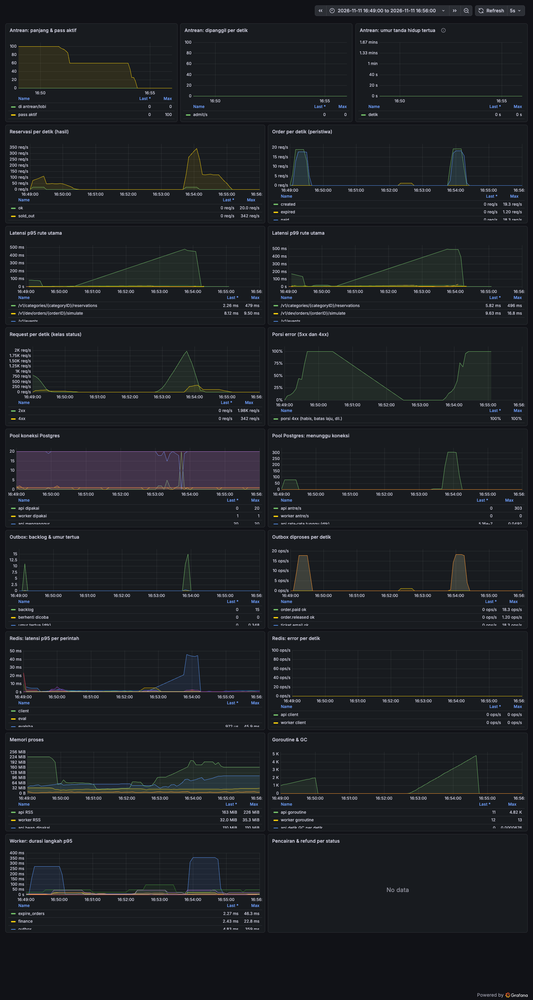

# 11 · Performa: metrik, uji beban, dan batasnya

Semua angka di sini berasal dari eksekusi nyata di satu laptop (lihat [Batasan](#batasan-yang-jujur)). Ini **bukan** jaminan produksi dan bukan klaim "tahan N pengguna" di luar yang diukur. Cara mengulang ada di [loadtest/README.md](../loadtest/README.md) dan [08-development.md](08-development.md#uji-beban--metrik).

## Ringkasan

| Pertanyaan | Jawaban terukur |
| --- | --- |
| Pernah oversell? | **Tidak**, di semua eksekusi `war*`, `soak`, dan chaos: tiket terbit ≤ kuota, tanpa BIB ganda, ledger seimbang |
| Dengan antrean, 5.000 pengguna berebut 500 tiket | 0 error 5xx, p95 reservasi 1,8 ms, 297 req/dtk. Tidak ada ambang yang gagal |
| Tanpa antrean, ukuran yang sama | p95 reservasi **425 ms** (ambang 300 ms **gagal**), tetap 0 oversell dan 0 5xx. Inilah alasan antrean ada |
| Kerusakan yang ditemukan | Redis di-kill → stok Redis jadi lebih longgar dari kuota (oversell mungkin). **Diperbaiki** (`StockReconciler`), dengan tes |
| Titik sempit | Pool koneksi Postgres (20) saat ribuan pengunjung membaca bersamaan tanpa antrean |
| Overhead metrik | Tidak terukur (di dalam derau) |
| Biaya observabilitas | Prometheus ±40 MiB, Grafana ±130–340 MiB, CPU < 6% satu core. Opsional, tidak ikut stack produksi |

## Lingkungan

| | |
| --- | --- |
| Mesin | Apple M2, 8 core (4P+4E), 16 GB, macOS 27.0.1 |
| Docker | OrbStack 2.2.5: 8 CPU, 8 GB RAM yang dialokasikan |
| Go | 1.27.4 (API + worker native di macOS, bukan di container) |
| Postgres | 17.11 (container, `pg_stat_statements` menyala, `max_connections` bawaan 100) |
| Redis | 7.4.12 (container, AOF `appendfsync everysec`, `noeviction`, `maxmemory 256mb`, sama dengan produksi) |
| Generator beban | k6 2.3.0 di container, di mesin yang sama |
| Konfigurasi uji | `APP_ENV=development`, pembayaran mock, SMTP ke Mailpit uji, `TRUSTED_PROXY_HOPS=1`, `QUEUE_ADMIT_PER_SEC=20`, `QUEUE_MAX_ACTIVE=300`, `RESERVATION_TTL=1m` (produksi 15m, dipendekkan supaya slot yang ditinggal kembali dalam menit, bukan seperempat jam), `DB_MAX_CONNS=20` kecuali disebut |

Infra uji (Postgres, Redis, Mailpit) berdiri sendiri di `docker-compose.loadtest.yml` (proyek `racego-loadtest`, port 55439/6381/1026): data development dan `.env` tidak pernah dipakai atau disentuh.

## Metode

1. **Pengguna sintetis tanpa pintu belakang.** `migrate loadgen-seed` membuat N pengguna + sesi biasa langsung di database. Ia menolak jalan bila `APP_ENV` bukan `development` atau nama database bukan `*_loadtest` (tes: `TestLoadgenOnlyDevelopmentAndLoadtestDB`; diuji nyata terhadap database dev dan `APP_ENV=production`: keduanya ditolak). Server tidak punya jalan pintas autentikasi baru.
2. **Pembatas laju tetap menyala.** Tiap pengguna membawa `X-Forwarded-For` sendiri (±32 pengguna per IP, seperti NAT kampus) dan `TRUSTED_PROXY_HOPS=1`. Tidak ada 429 dalam eksekusi mana pun: batas wajar tidak mengganggu klien yang mengikuti `poll_after_ms`.
3. **Klien berperilaku seperti manusia** (`loadtest/war.js`): datang acak ±60 detik dari jam buka, masuk antrean, polling sesuai `poll_after_ms`, reservasi, mengisi data (2–8 dtk), order, memilih metode (1–4 dtk), bayar lewat rute simulasi mock, lalu menunggu tiket. 15% menyerah di tengah (menutup tab saat antre, tidak jadi order, atau tidak jadi bayar). 5xx dan kegagalan jaringan diulang dengan backoff 1, 2, 4, … 8 dtk.
4. **Integritas otomatis** (`migrate loadgen-check`) sesudah tiap `war*`/`soak`, dengan menunggu outbox kosong dan hold/order yang ditinggal kedaluwarsa: (a) tiket per kategori ≤ kuota dan order lunas = tiket, (b) tanpa BIB/tiket ganda, (c) batas per pembeli, (d) `ledger/check` hijau dan tepat satu jurnal `order.paid` per order lunas, (e) stok Redis = kuota − terjual − ditahan, (f) tanpa order `pending` yatim dan outbox kosong, (g) tiap yang tidak kebagian menerima jawaban "habis", bukan 5xx (ambang k6 `unexpected == 0`). Satu pemeriksaan gagal = eksekusi gagal.
5. **Ambang (SLO uji)** di skrip k6: p95 reservasi < 300 ms, p95 `queue/me` < 300 ms, p95 join < 500 ms, p95 order < 800 ms, p95 tiket terbit setelah bayar < 10 dtk, 5xx < 1%, tiket ≤ kuota. Angka ini pilihan kami untuk pengalaman yang wajar, bukan standar.

## Hasil

Satu eksekusi per baris (belum ada pengulangan, jadi perlakukan selisih kecil sebagai derau). Kuota 500 tiket di 3 kategori (250/150/100), maksimal 1 tiket per pembeli per kategori. Latensi dalam ms (sisi klien, k6): p50 / p95 / p99.

| Skenario | Ukuran | Throughput | Reservasi | `queue/me` | Order | 5xx | Tiket | Oversell | Integritas | Ambang |
| --- | --- | --- | --- | --- | --- | --- | --- | --- | --- | --- |
| `browse` | 50 VU, 40 dtk | 24 req/dtk | - | - | - | 0 | - | - | - | lulus (daftar 2,2/3,6/5,0; detail 3,1/4,9/5,8) |
| `war` (asap) | 100, kuota 30 | 13 req/dtk | 1,5/2,6/4,1 | 2,9/4,4/6,1 | 10/17,5/19 | 0 | 26 | 0 | lulus | lulus |
| `war` | 500 | 29 req/dtk | 1,5/2,6/3,8 | 1,6/4,0/4,7 | 8/12,5/13,7 | 0 | 437 | 0 | lulus | lulus |
| `war` | 2.000 | 146 req/dtk | 1,1/2,0/2,8 | 1,7/3,3/4,8 | 6,8/11,3/16,2 | 0 | 493 | 0 | lulus | lulus |
| `war` | 5.000 | 297 req/dtk | 1,0/1,8/2,3 | 1,3/3,4/5,7 | 6,3/10,3/13 | 0 | 497 | 0 | lulus | lulus |
| `war-noqueue` | 2.000 | 290 req/dtk | 2,3/**60,7**/229 | - | 4,9/8,5/11,7 | 0 | 444 | 0 | lulus | lulus |
| `war-noqueue` | 5.000 | 686 req/dtk | 2,3/**425**/458 | - | 5,5/11,6/15,8 | 0 | 458 | 0 | lulus | **gagal**: reservasi p95 425 > 300 |
| `soak` | 3.000 akun, 10 mnt, 3 pembelian/dtk + 30 pengunjung | 30 req/dtk | 3,7/7,3/9,9 | - | 10/14/18 | 0 | 1.786 | 0 | lulus | lulus (setelah perbaikan skrip, lihat bawah) |

Antrean (`war`): admit 20/dtk (bawaan). Waktu tunggu antre p50 / p95: 500 → 9,7 s / 61 s; 2.000 → 53 s / 244 s; 5.000 → 51 s / 248 s. Pada 2.000 dan 5.000 pengguna, 1.241 dan 4.097 masih menunggu saat batas uji 5 menit berakhir. Itu artefak batas uji dan `RESERVATION_TTL=1m`, bukan kerusakan: slot yang ditinggal kembali baru setelah TTL + 2 menit tenggang, dan selama stok 0 dengan hold masih beredar antrean sengaja menahan pemanggilan. Di produksi (TTL 15 menit) pengantre bisa melihat "menunggu" sampai ±17 menit setelah kuota habis sebelum antrean menyatakan "habis". Itu perilaku desain (slot yang kembali diberikan ke pengantre berikutnya), tapi layak diketahui.

Tiket terbit setelah bayar: p95 1–4 dtk di semua skenario normal (worker mengosongkan outbox tiap 500 ms).

Sumber daya pada puncak (satu mesin, angka CPU adalah persen satu core):

| | `war` 5.000 | `war-noqueue` 5.000 |
| --- | --- | --- |
| API | 15% CPU, RSS 255 MB | 66% CPU, RSS 209 MB, 4,8 ribu goroutine |
| Postgres | 10% | 39% |
| Redis | 7% | 8% |
| k6 | 1,78 GiB RAM | (tidak dicatat) |

### Dashboard

Saat `war-noqueue` 5.000 (antre pool Postgres 303/dtk, goroutine 4,8 ribu, reservasi p95 ±480 ms; 4xx = jawaban "habis"):

### Soak

10 menit, 1.786 tiket terbit. Diukur tiap 30 dtk:

| | awal (t+30s) | akhir (t+600s) |
| --- | --- | --- |
| Goroutine API / worker | 103 / 12 | 103 / 13 |
| RSS API / worker | 34 / 25 MB | 38 / 31 MB (naik hanya di 5 menit pertama, lalu datar) |
| File descriptor API | 127 | 112 |
| Koneksi Postgres | 23 | 9 |
| Backlog outbox | 0–4 | 0–4 |
| Kunci Redis | 10.750 | 14.176 |

Tidak ada kebocoran goroutine, memori, fd, atau koneksi. **Kunci Redis tumbuh linear**: ±5,7 kunci/dtk pada 3 pembelian/dtk, yaitu 2 kunci per tiket (penanda `confirmed:<rid>` dengan TTL 90 hari dan kunci jumlah milik pembeli). Memori Redis naik 3,6 → 4,1 MB untuk 1.786 tiket (±0,3 KB per tiket), jadi batas 256 MB produksi cukup untuk ratusan ribu tiket. Bukan masalah sekarang, tapi tidak pernah berkurang sebelum TTL-nya habis.

Pertama kali dijalankan, `soak` gagal ambang `unexpected` (15). Ternyata bug skrip, bukan server: `soak.js` mulai 5 detik sebelum jam buka, dan 15 reservasi pertama dijawab `sale_not_open` yang sah (metrik server: `ok=1786` = tiket, `sale_not_open=15`, 5xx 0). `setup()` kini menunggu jam buka; eksekusi ulang 90 detik: `unexpected = 0`, integritas lulus.

## Titik sempit dan penyetelan

**Temuan:** pada `war-noqueue` 5.000, p95 reservasi 425 ms. Kueri tidak lambat: `pg_stat_statements` menunjukkan kueri terpanas hanya 0,013–0,018 ms per panggilan (detail event, kategori, pencarian sesi). Yang lambat adalah **menunggu koneksi dari pool**: `racego_db_pool_wait_total` 10.039 dan total 1.715 dtk menunggu. Setiap request terautentikasi memakai satu koneksi Postgres untuk mencari sesi, dan 5.000 pengunjung yang me-refresh halaman event tiap detik berebut 20 koneksi. Sisi Redis sehat (CPU 8%, `evalsha` p50 1 ms). `evalsha` p95 tercatat ≤100 ms di sisi API; dugaan kami itu antrean koneksi klien Redis (pool 50) atau penjadwalan goroutine di API yang jenuh, bukan Redis, tetapi itu belum dibuktikan terpisah.

**Perubahan (satu hal): ukuran pool jadi env `DB_MAX_CONNS`** (bawaan tetap 20, tes `TestDBMaxConns` termasuk nilai ngawur ditolak saat start). Diukur ulang `war-noqueue` 5.000:

| | reservasi p95 | menunggu pool (wait / total dtk) | 5xx | Oversell | Integritas |
| --- | --- | --- | --- | --- | --- |
| `DB_MAX_CONNS=20` (eksekusi awal) | 425 ms | 10.039 / 1.715 | 0 | 0 | lulus |
| `DB_MAX_CONNS=20` (ulang) | 336 ms | 8.857 / 1.317 | 0 | 0 | lulus |
| `DB_MAX_CONNS=50` | **221 ms** | 7.116 / 807 | 0 | 0 | lulus |

Catatan jujur: satu eksekusi per konfigurasi, dan dua eksekusi dengan nilai sama selisih 26%, jadi arahnya meyakinkan (waktu tunggu pool turun 40–50%) tetapi besarnya tidak. Bawaan **tidak diubah**: dengan antrean (`war`) pool 20 tidak pernah menjadi masalah. Pakai `DB_MAX_CONNS` hanya bila `racego_db_pool_wait_total` terus naik; jumlah koneksi semua proses (API + worker, tiap instance) harus di bawah `max_connections` Postgres.

**Yang diperiksa dan sengaja tidak diubah** (tidak terbukti perlu): cache sesi per request (kueri sesi hanya 0,014 ms, 1,3 dtk total untuk 93 ribu panggilan; cache akan melemahkan pencabutan sesi seketika), indeks (`EXPLAIN ANALYZE` pada database uji dengan 1.000 sesi, 9.415 order, 36 event, 85 kategori: kueri sesi memakai `Index Scan` pada `token_hash` dan selesai 0,15 ms; kueri kategori 0,07 ms dan detail event 0,03 ms memakai `Seq Scan` karena tabelnya kecil dan planner menilainya lebih murah daripada index, yang tetap ada untuk saat tabel membesar), pool Redis, jumlah worker, konfigurasi Redis. Semantik reservasi, ledger, dan keamanan tidak disentuh.

**Overhead instrumentasi:** empat eksekusi bergantian (biner sebelum metrik, commit `35d3514`, vs sekarang), `war-noqueue` 1.500 pengguna, 13.2–13.5 ribu request tiap eksekusi:

| | lama | baru |
| --- | --- | --- |
| Throughput | 243 dan 245 req/dtk | 243 dan 247 req/dtk |
| Reservasi p50 | 1,1 dan 1,3 ms | 1,3 dan 1,2 ms |
| Reservasi p95 | 76 dan 72 ms | 70 dan 55 ms |
| Order p95 | 8,6 dan 8,8 ms | 8,7 dan 8,8 ms |

Tidak ada beda di luar derau antar-eksekusi.

## Chaos ringan

`war` 1.000 pengguna (kuota 500), gangguan sekitar 20 detik sesudah jam buka, lalu pemeriksaan integritas penuh setelah semuanya reda.

| Gangguan | Yang dilihat pengguna | Integritas |
| --- | --- | --- |
| **Redis `stop` lalu `start`** (±9 dtk mati) | Selama mati: 1.377 respons 500 (join/status antrean dan order). Klien yang mengulang dengan backoff pulih semua; 0 pengguna berakhir gagal. Worker mencatat error antrean sesaat | Lulus semua (a–f), 0 oversell |
| **Redis di-`SIGKILL`** (±9 dtk mati, AOF `everysec`) | Sama, plus 22 pembeli yang reservasinya hilang menerima 410 `reservation_expired` dan harus antre/reservasi lagi | **Gagal (e) sebelum perbaikan**: stok Redis 255/158/103 untuk kuota 250/150/100. Setelah perbaikan: lulus |
| **Worker mati 25 dtk** | Tidak ada error. Tiket tertunda: p95 25 dtk (ambang 10 dtk gagal, wajar) lalu terbit setelah worker hidup; outbox mengejar sendiri | Lulus semua, 0 oversell |

### Bug yang ditemukan: stok Redis lebih longgar dari kuota setelah crash

Redis dengan AOF `everysec` kehilangan ≤1 detik tulisan terakhir saat di-kill. Reservasi yang baru dibuat (pengurangan stok + catatan hold) hilang bersama-sama, sehingga stok Redis lebih besar daripada kuota − slot terpakai (16 slot di eksekusi itu). Tiket tetap ≤ kuota di eksekusi itu, tetapi selisih tersebut adalah jalan menuju oversell begitu stok benar-benar habis, dan tidak ada yang memperbaikinya (`SyncCategory` hanya mengisi stok yang belum ada).

**Perbaikan:** `checkout.StockReconciler` (`backend/internal/checkout/reconcile.go`, `lua/clamp.lua`), dijalankan worker tiap 15 detik. Invarian: stok Redis ≤ kuota − slot order `pending`/`paid` (dari database). Ia **hanya menurunkan** stok, dan baru bertindak bila kelebihan terlihat di **dua putaran berturut-turut** (perubahan kuota menyesuaikan Redis sebelum commit database, jadi kenaikan kuota yang sedang berjalan sempat tampak sebagai kelebihan sesaat). Salah arah paling buruk berarti menjual lebih sedikit, bukan oversell. Metrik: `racego_stock_clamped_slots_total`; log `WARN stok Redis lebih besar dari kuota − order aktif`. Tes: `TestStockReconcilerClampsAfterLostWrites` (mereproduksi kehilangan 3 pengurangan; sesudah dijepit tepat 6 slot terjual dan yang ke-7 habis) dan `TestStockReconcilerIgnoresTransientAndNeverRaises`.

**Bukti sebelum/sesudah** (eksekusi ulang SIGKILL dengan perbaikan): worker menjepit kategori yang rusak (log: 27→22, 26→18, 18→15, 24→16, 8→5, kategori dari eksekusi lama ikut terbersihkan), dan pada event baru stok 31 → 26 sehingga (e) = tepat kuota. Catatan: selisih baru terlihat setelah hold yatim kedaluwarsa dan dijepit ≤30 dtk kemudian, jadi `loadgen-check` kini menunggu konvergensi (`--converge`, 60 dtk) sebelum menyatakan (e) gagal.

**Celah yang tersisa setelah Tugas 9** (ditutup di Tugas 11, lihat bagian di bawah): (1) oversell di jendela sebelum rekonsiliasi: **tertutup oleh pagar kuota di database**; (2) kunci jumlah milik pembeli yang hilang: **tertutup oleh `RestoreUserLimits`**; (3) antrean virtual yang hilang karena Redis di-kill membuat pengantre tidak ada di antrean; mereka harus masuk lagi (terlihat sebagai `not_in_queue`, klien k6 masuk ulang). Butir (3) tetap terbuka.

## Pengerasan stok (Tugas 11)

Prinsip: database sumber kebenaran jumlah tiket sah, Redis jalur cepat ([03](03-war-tiket.md#pelindung-berlapis-tugas-11)). Semua angka di bawah: `war` 2.000 pengguna, kuota 500 (250/150/100), infra uji yang sama dengan Tugas 9 (Redis AOF `everysec` kecuali disebut), satu mesin untuk k6, API, worker, Postgres, Redis. Satu eksekusi per baris kecuali disebut; derau antar-eksekusi besar (lihat `after2`).

**Bukti pagar di bawah beban nyata** (`loadgen-check`; chaos terjadi ±110 dtk setelah mulai):

| Eksekusi | Tiket terbit / kuota (5K, 10K, 21K) | Order `needs_refund` | BIB ganda | Ledger | Hasil |
| --- | --- | --- | --- | --- | --- |
| kode lama, tanpa chaos | lulus | 0 | 0 | seimbang | lulus |
| **kode lama, Redis `SIGKILL`** | **251**/250, 150/150, 99/100 | 0 | 0 | seimbang | **gagal: oversell** (a1, e) |
| kode lama, `FLUSHALL` | 241/250, 139/150, 97/100 | 7 | 0 | seimbang | a3 dan e gagal (lihat catatan 2) |
| kode baru, tanpa chaos | 246, 150, 98 | 0 | 0 | seimbang | lulus |
| **kode baru, Redis `SIGKILL`** | 250, 149, 100 (**≤ kuota**) | **23**, semuanya ditolak pagar (23 baris log + metrik) | 0 | seimbang | lulus |
| kode baru, `FLUSHALL` | 235, 147, 95 | 8 | 0 | seimbang | lulus |
| kode baru, `appendfsync always` + `SIGKILL` | 248, 148, 98 | 0 | 0 | seimbang | lulus |

Kode lama pada `SIGKILL` mereproduksi oversell (251 tiket untuk kuota 250); kode baru pada pengulangan yang sama menahan tiket di kuota dan mengubah 23 order lunas yang kelebihan menjadi `needs_refund` (tanpa tiket, tanpa jurnal `order.paid`; refund lewat jalur Tugas 6). Respons 5xx pada eksekusi `SIGKILL` (±3.100 hitungan `unexpected` k6, sama dengan kode lama) seluruhnya `connection refused` ke Redis selama ±8 dtk Redis mati (join/status antrean); pembeli yang mengulang pulih. Tidak ada 5xx di eksekusi `FLUSHALL`; `unexpected` 8 di sana = 8 pembeli yang order-nya `needs_refund`.

Catatan 1. Eksekusi pertama "after/flush/kill" ternyata memakai worker lama karena `run.sh` tidak memulai ulang proses yang masih hidup; hasilnya disimpan sebagai pembanding "kode lama" di atas, lalu seluruhnya diulang dengan kode baru setelah `run.sh stop`. Catatan 2. Pada `FLUSHALL`, order yang pembayarannya masuk setelah hold-nya hilang diproses `confirm.lua` sebagai "bayar telat": stok yang baru dimuat ulang sudah mengurangi order itu, jadi `Confirm` mengambilnya lagi dan, bila stok habis, menjawab `needs_refund` walau tiket terbit (477) masih di bawah kuota (500). Ini perilaku lama (7 order sebelum, 8 sesudah), bukan pagar; pembeli direfund dan slotnya tidak dijual ulang (menjual lebih sedikit, arah aman). `loadgen-check --allow-needs-refund` (otomatis saat `CHAOS`) kini hanya menggagalkan stok+ditahan+terjual **lebih besar** dari kuota. Memperbaiki perilaku itu (menerbitkan bila database masih punya ruang) mengubah semantik bayar telat dan di luar cakupan.

**Regresi performa** (tanpa chaos; ms sisi klien k6; p50 / p95 reservasi, p95 order, p95 tiket terbit setelah bayar):

| Eksekusi | Reservasi | Order p95 | Tiket terbit p95 | req/dtk |
| --- | --- | --- | --- | --- |
| kode lama #1 | 1,63 / 4,12 | 20,3 | 1.009 ms | 152 |
| kode lama #2 | 1,51 / 3,31 | 15,6 | 1.007 ms | 152 |
| kode baru #1 | 1,51 / 3,07 | 16,7 | 1.007 ms | 150 |
| kode baru #2 | 1,51 / 8,5 | 128,7 | 1.145 ms | 152 |

Pagar menambah dua kueri kecil (kunci baris kategori, hitung tiket lewat indeks baru `tickets_category_idx`) di transaksi penerbitan, tidak di jalur reservasi. Kode baru #1 tidak berbeda dari kode lama; kode baru #2 punya satu lonjakan (order p95 129 ms, reservasi p95 8,5 ms) yang mirip derau ±25% yang sudah dicatat di Tugas 9 dan tidak muncul pada dua eksekusi `always` yang memakai kode sama. Kesimpulan: tidak ada kemunduran terukur; waktu tiket terbit tetap ±1 dtk (interval outbox 500 ms).

**Evaluasi `appendfsync`** (kode baru, `war` 2.000, `docker-compose.loadtest.yml` dengan `REDIS_APPENDFSYNC`):

| Mode | Reservasi p50 / p95 | Order p95 | Tiket terbit p95 | req/dtk | Stok yang "hilang" saat `SIGKILL` (dijepit reconciler) | Hasil `SIGKILL` |
| --- | --- | --- | --- | --- | --- | --- |
| `everysec` (bawaan), 3 eksekusi | 1,5 / 3,1–8,5 | 16,7–128 | 1.007–1.145 ms | 150–152 | **11 slot** (5 penjepitan di kategori 5K, 3–5 menit setelah kill) | tiket ≤ kuota, 23 `needs_refund` |
| `always`, 2 eksekusi | 3,0 / 8,9 dan 9,0 | 16,0 dan 19,4 | 1.005 ms | 150 | **0** | tiket ≤ kuota, 0 `needs_refund` (eksekusi tunggal) |

`always` menggandakan p50 reservasi (1,5 → 3,0 ms) dan menaikkan p95 sedikit; throughput tidak berubah karena beban ditentukan kedatangan pengguna, bukan kapasitas, dan seluruhnya jauh di bawah ambang 300 ms. **Keputusan: bawaan produksi tetap `everysec`.** Alasan: dengan pagar database, kehilangan ≤1 dtk tulisan Redis tidak bisa lagi menjadi tiket berlebih, hanya order yang kelebihan menjadi `needs_refund` (23 dari 500 pada uji `SIGKILL` kasar saat 2.000 pengguna berebut, dengan Redis mati ±8 dtk) dan dijepit reconciler; harga `always` adalah latensi tetap dua kali lipat di setiap reservasi. Operator yang tidak mau ada pembeli yang perlu refund karena crash Redis boleh memilih `always` lewat `REDIS_APPENDFSYNC` di `.env.prod` (nilai selain `everysec|always|no` membuat Redis gagal start dengan pesan jelas; diuji). Angka satu mesin, bukan jaminan produksi.

**Kunci batas per pembeli.** `RestoreUserLimits` (worker; `checkout/userlimits.go`) membangun ulang `{cat:<id>}:user:<uid>` dari order `paid` dan `pending` yang reservasinya masih berlaku, hanya menaikkan, idempoten, dengan TTL sama dengan aturan reservasi. Dipanggil saat stok kategori dimuat ulang (jalur yang juga dipakai checkout setelah Redis kosong) dan tiap ±2 menit oleh reconciler. Dipilih dibanding pemeriksaan database di checkout supaya jalur panas tetap satu skrip Lua. Jendela tersisa: pembeli yang kuncinya hilang bisa melewati batas sampai stok dimuat ulang atau putaran berikutnya (≤2 menit). Bukti: tes `TestUserLimitRestoredFromDatabase`; uji manual (pembeli lunas 1 tiket, batas 1, `FLUSHALL`, reservasi kedua tetap ditolak 409 `limit_exceeded`, pembeli lain 201); dan eksekusi `FLUSHALL` di bawah beban memulihkan batas 139 + 91 pembeli (log `batas per pembeli dipulihkan`).

**Celah yang tersisa:** order yang ditolak pagar membuat pembeli membayar tanpa tiket sampai direfund (manual lewat portal/super admin; belum otomatis); slot order `needs_refund` tidak kembali ke penjualan (keputusan Tugas 6, stok sedikit di bawah kuota setelah chaos); perilaku "bayar telat" pada `FLUSHALL` di atas; antrean virtual hilang bila Redis kehilangan data. Satu eksekusi per konfigurasi, satu mesin.

## Temuan lain (di luar cakupan, dicatat saja)

- `inventory:categories` (daftar kategori yang dipantau worker) tidak pernah dipangkas untuk event yang sudah ditutup; `releaseExpiredHolds` dan penjepit memindainya tiap 15 detik. Aman sekarang, tumbuh seiring jumlah event.
- `POST /v1/dev/orders/{id}/simulate` tidak memeriksa pemilik order (hanya aktif di development/mode mock, tapi di demo publik mock ini terbuka).
- Pengunjung anonim dan terautentikasi sama-sama memukul Postgres untuk `GET /v1/events/{id}` (dua kueri); header `Cache-Control: public, max-age=2` sudah ada, jadi CDN bisa menyerapnya (lihat peta skala).

## Metrik dan dashboard

Aktifkan dengan `METRICS_ADDR` (API) dan `WORKER_METRICS_ADDR` (worker): listener **terpisah** dari server publik, bawaan mati. Non-loopback wajib `METRICS_TOKEN` (`Authorization: Bearer`, dibandingkan konstan-waktu); tanpa token API/worker menolak start dengan pesan yang jelas. Di development listener yang sama menyajikan `/debug/pprof/`.

Seri (awalan `racego_`): `http_requests_total` dan `http_request_duration_seconds` per metode/**pola rute chi**/kelas status, `reservations_total{result}`, `orders_total{event}`, `queue_size`, `queue_active_passes`, `queue_admitted_total`, `queue_oldest_heartbeat_age_seconds`, `outbox_backlog|dead|oldest_age_seconds`, `outbox_processed_total{topic,result}`, `worker_step_duration_seconds{step}`, `db_pool_*` (acquired/idle/total/max/wait/durasi tunggu), `redis_command_duration_seconds{cmd}` dan `redis_errors_total`, `emails_total{result}`, `payouts{status}`, `refunds{status}`, `stock_clamped_slots_total`, ditambah `go_*` dan `process_*` bawaan. Penyimpangan dari rancangan awal: "usia antrean tertua" adalah umur *tanda hidup* tertua (waktu masuk tidak disimpan di antrean; semantiknya tidak diubah).

**Label aman.** Hanya himpunan kecil dan tetap. Tes `TestMetricsOutputSafe` mengirim 5.100 request sintetis yang sengaja membawa UUID, email, token, IP, path acak, dan metode liar, lalu memeriksa seluruh keluaran `/metrics`: 1.120 deret saat seluruh paket dijalankan (batas 2.500), tidak ada UUID/email/IP/token, tiap label `route` adalah pola yang terdaftar di router atau `unmatched`.

**Dashboard** (`make obs-up`): 19 panel, di-*provision* dari berkas (`deploy/obs/`). Grafana bind `127.0.0.1:3001`, kata sandi admin acak dibuat `make obs-up` ke `.env.obs` (di-`.gitignore`, tidak ada di repo), tanpa pendaftaran/anonim/telemetri/cek pembaruan/plugin.

## Komponen baru, lisensi, dan biaya

Semua gratis, open source, dan berjalan lokal di Docker/Mac. Tidak ada akun, layanan berbayar, trial, kartu, Grafana Cloud, SaaS pemantauan, atau agen yang mengirim data keluar. Tidak ada panggilan ke Midtrans/Cloudflare/SMTP sungguhan (pembayaran mock, email ke Mailpit uji, Turnstile mati); skrip k6 menolak `BASE_URL` selain localhost/jaringan Docker lokal.

| Komponen | Versi | Lisensi | Jalan di |
| --- | --- | --- | --- |
| `prometheus/client_golang` (+ `client_model`, `common`, `procfs`, `perks`, `goautoneg`, `protobuf`) | 1.25.0 (0.6.3, 0.72.0, 0.22.0, 1.0.1, -, 1.36.12) | Apache-2.0 (client_golang terverifikasi di `LICENSE`; lainnya Apache-2.0/MIT/BSD-3 menurut upstream) | di dalam biner API/worker |
| k6 | 2.3.0 (`grafana/k6`) | AGPL-3.0 | container lokal, hanya saat uji; tidak didistribusikan |
| Prometheus | 3.16.0 | Apache-2.0 | `docker-compose.obs.yml`, laptop |
| Grafana OSS | 13.0.2 | AGPL-3.0 | `docker-compose.obs.yml`, laptop |
| Mailpit | 1.31.6 | MIT | `docker-compose.loadtest.yml`, laptop |
| Postgres / Redis | 17.11 / 7.4.12 | image yang sama dengan development | `docker-compose.loadtest.yml`, laptop |

`govulncheck` pada pustaka baru: bersih. Ia menemukan satu celah `net/http` di stdlib Go 1.27.3 (GO-2026-6859, diperbaiki di 1.27.4), sehingga `go.mod`, `backend/Dockerfile`, dan dokumen dinaikkan ke Go 1.27.4; sesudahnya "No vulnerabilities found".

**Stack produksi tidak bertambah service maupun memori.** `git diff docker-compose.prod.yml` hanya menambah tiga variabel opsional (`METRICS_TOKEN`, `METRICS_ADDR`, `WORKER_METRICS_ADDR`), semuanya kosong secara bawaan. Dibuktikan dengan menaikkan stack produksi di proyek terpisah:

- `curl -k https://localhost:8443/metrics` lewat Caddy → **404** (juga `/v1/metrics`); `/healthz` → 200. Hanya Caddy yang membuka port ke host.
- `METRICS_ADDR=:9464` tanpa token → API menolak start: `konfigurasi tidak valid: METRICS_ADDR=":9464" bukan alamat loopback: isi METRICS_TOKEN, …`.
- Dengan token, dari jaringan Docker internal: tanpa token 401, token salah 401, token benar 200 (111 deret `racego_` di API, `racego_outbox_backlog` di worker). Port itu tidak dipublikasikan ke host.

**Jejak sumber daya Prometheus + Grafana** (diukur selama `war` 2.000/5.000 dan idle; `docker stats`):

| | CPU | RAM | Lain |
| --- | --- | --- | --- |
| Prometheus | ≤0,8% (idle 0,2%) | 31–45 MiB | data 4,2 MB untuk ±2 jam, retensi 2 hari/512 MB, image 364 MB |
| Grafana | ≤5,7% (idle 0,4%) | 130–338 MiB | image 1,38 GB |

Totalnya sekitar 170–380 MiB RAM dan I/O disk kecil: terlalu mahal untuk VPS 1–2 GB yang juga menjalankan Postgres, Redis, API, worker, web, dan Caddy (batas memori stack produksi sudah ±3 GB). Jalankan hanya di laptop; di VPS biarkan `METRICS_ADDR` kosong.

## Batasan yang jujur

- **Generator dan server berbagi CPU** (8 core, bersama Docker VM, Postgres, Redis, k6, dan Grafana). Angka adalah **batas bawah**: server terpisah akan lebih baik, tetapi jaringan nyata menambah latensi yang tidak terukur di sini.
- Semua lewat loopback: tanpa latensi jaringan, TLS, Cloudflare, atau Caddy. Pembayaran mock membalas dalam milidetik; Midtrans sungguhan lebih lambat dan webhook bisa terlambat.
- **Satu eksekusi per konfigurasi**, tanpa interval kepercayaan. Derau antar-eksekusi terlihat ±25% (dua eksekusi identik: p95 425 vs 336 ms). Bandingkan urutan besarnya, bukan selisih kecil.
- 5.000 pengguna adalah **pengguna aktif bersamaan** di satu mesin. Bukan "5.000 orang di internet": koneksi dari 5.000 perangkat berbeda berperilaku lain (reconnect, jaringan buruk, bot).
- `RESERVATION_TTL=1m` dan batas tunggu 5 menit membuat banyak pengguna terlihat "masih menunggu"; itu parameter uji.
- Kuota kecil (500) dibanding ukuran pengguna; event berkuota puluhan ribu belum diuji. Satu kategori panas berada di satu slot Redis (hash tag `{cat:<id>}`), jadi throughput per kategori dibatasi satu thread Redis.
- Tidak ada pengujian dari beberapa wilayah, terhadap Midtrans/Cloudflare sungguhan, dengan Redis Cluster, atau dengan banyak instance API/worker.
- Chaos hanya tiga gangguan sederhana, masing-masing sekali. Tidak diuji: Postgres mati, jaringan terpisah sebagian, disk penuh, API mati di tengah `CreateOrder`.
- Alerting, tracing, dan log terpusat di luar cakupan dan belum ada.

## Peta skala bertahap

Urutan di bawah mengikuti temuan, bukan firasat: lakukan berikutnya hanya bila metrik menunjukkan perlu. Tidak ada klaim bahwa langkah-langkah ini sudah diuji.

| # | Langkah | Kapan | Biaya |
| --- | --- | --- | --- |
| 1 | **Selalu pakai antrean** untuk event yang diburu (`QUEUE_ADMIT_PER_SEC`, `QUEUE_MAX_ACTIVE` disetel ke kemampuan server) | Sebelum apa pun; tanpa antrean reservasi p95 melewati 300 ms di 5.000 pengunjung | Gratis |
| 2 | **CDN Cloudflare gratis** untuk halaman publik dan `GET /v1/events*` (header `Cache-Control` sudah ada) | `racego_db_pool_wait_total` naik karena pembacaan publik | Gratis (paket Free); ketentuan layanan melarang uji beban lewat Cloudflare |
| 3 | **Naikkan `DB_MAX_CONNS`** (mis. 40–50) | Pool jenuh, Postgres masih lega | Gratis; RAM Postgres naik sedikit |
| 4 | **Cache sesi pendek** (Redis/memori, TTL beberapa detik, dihapus saat logout) | Kueri sesi menjadi beban terukur | Gratis; melemahkan pencabutan sesi seketika sebesar TTL, harus ditimbang |
| 5 | **PgBouncer** (OSS) di depan Postgres | Banyak instance API/worker memakan koneksi | Gratis; satu container tambahan |
| 6 | **Beberapa instance API dan worker** | CPU API jenuh (di sini 66% satu core pada beban terberat) | Gratis software; **berbayar** bila butuh server tambahan. API tanpa state lokal selain cache 3 detik; worker aman paralel (`SKIP LOCKED`, Lua atomik) |
| 7 | **Replika baca Postgres** untuk `GET /v1/events*` dan laporan | Pembacaan publik tetap berat setelah CDN | Gratis software; **berbayar** untuk server/layanan kedua |
| 8 | **Redis terkelola atau `appendfsync always`** | Perlu menutup celah kehilangan tulisan saat crash, atau durabilitas lebih ketat | `always` gratis tapi menurunkan throughput; Redis terkelola **berbayar** |
| 9 | Redis Cluster / pemecahan kategori panas | Satu kategori menembus batas satu thread Redis (belum tercapai: evalsha p50 1 ms pada ±700 req/dtk) | **Berbayar** (server/layanan) dan perubahan arsitektur; tidak direkomendasikan sekarang |

Observabilitas produksi (Alertmanager, pemantauan uptime) tetap di [roadmap](09-roadmap.md); jangan menjalankan Prometheus/Grafana di VPS kecil.
